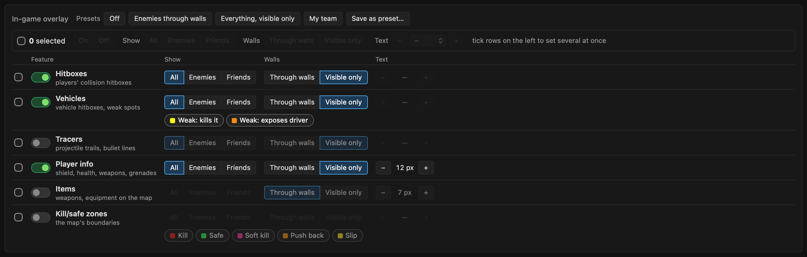
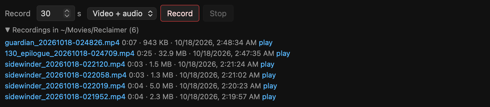
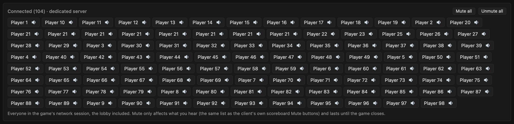
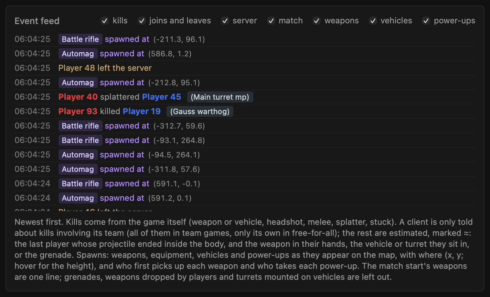
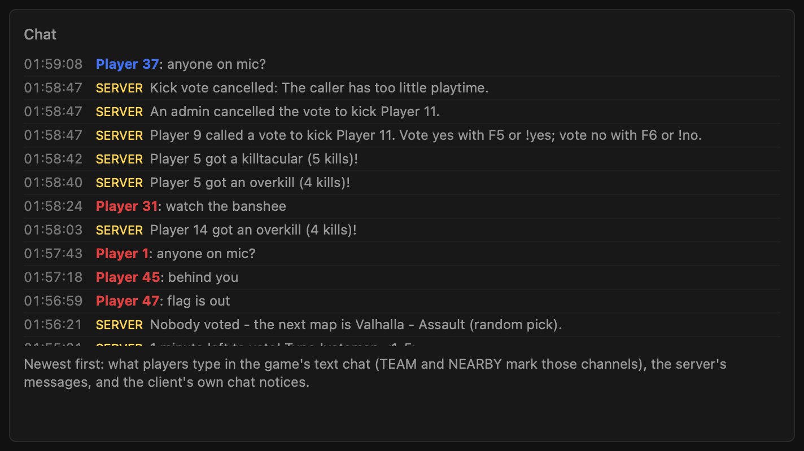
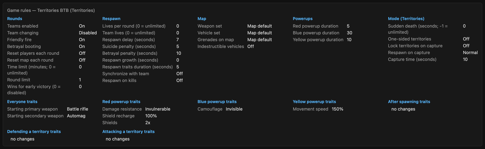
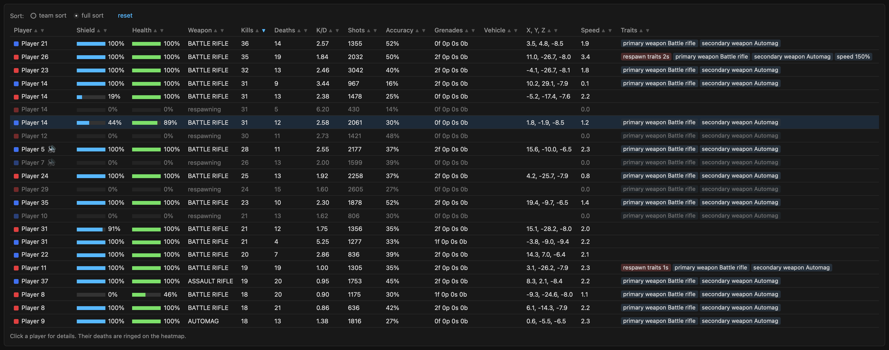
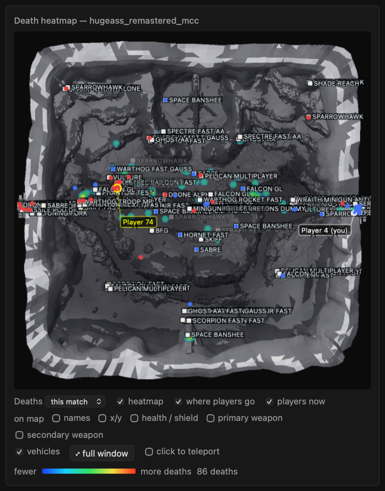
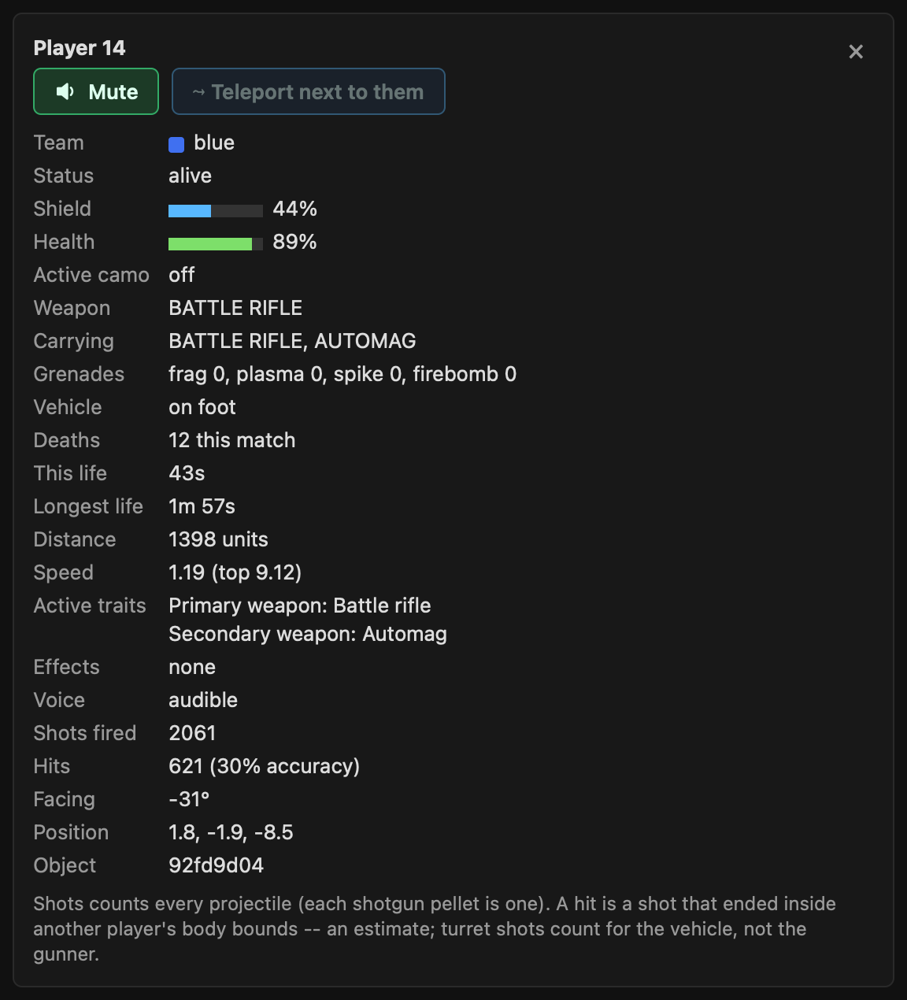

# Project Reclaimer on Apple Silicon — natively, without Wine

Runs [Project Reclaimer](https://projectreclaimer.dev) (the community Halo 3 client built on Halo: The
Master Chief Collection's `halo3.dll`) on an Apple Silicon Mac **without Wine, CrossOver or a VM**.

`shim/build/peload` is a from-scratch Win64 PE loader that runs under Rosetta 2. It loads the Reclaimer
client and MCC's `halo3.dll` directly and implements the Windows APIs they use, including:

- **Graphics:** a Direct3D 11 → OpenGL 4.1 (OpenGL-on-Metal) renderer with a DXBC → GLSL shader
  translator, and a CPU interpreter for the GPU particle compute shaders.
- **Audio:** XAudio2 on CoreAudio for the game, and a WASAPI output device on CoreAudio for the client's own
  menu music and voice chat.
- **Input:** XInput on GameController.framework, and Raw Input from macOS keyboard/mouse events.

## Status

**Playable**, starting from Reclaimer's own menu (Halo 3 menu scene with Server Browser, Campaign, Host
Game, Customize, Settings, Credits):
- **Host Game → Start Game** hosts a local Guardian Slayer match.
- **Server Browser** lists the public servers; double-click one (or select it and JOIN GAME) to join.
  The client joins the lobby (players, map vote), prepares the next map when the server rotates, and
  loads into the match. Only servers running the same client version can be joined; the
  browser shows other versions in red.
- In a match: correct rendering, lighting and shadows; the first-person weapon, particles, muzzle flash
  and explosions; the HUD and scoreboard (hold Tab or Back); the loading screen and game audio;
  controller (Xbox, DualSense, …) and keyboard/mouse.

On an M4 the menu is up about 17 s after launch, a hosted match loads in ~6 s, and gameplay averages
~85–120 fps depending on the map and scene. The window title shows the elapsed time, the load time and
the live frame rate (never more than the screen's refresh rate; when the engine runs faster, e.g. on
loading screens, its own rate is shown beside it).

Known gaps:
- **No MCC pause menu** (by design in standalone mode); F1 releases the mouse.
- **Frame-rate ceiling.** Performance is bound by OpenGL-on-Metal's per-draw-call cost.

## Requirements

- An Apple Silicon Mac with **Rosetta 2** (`softwareupdate --install-rosetta --agree-to-license`).
  Developed and tested on an M4 running macOS 26.
- Your own copy of **Halo: The Master Chief Collection** on Steam, with the Halo 3 Multiplayer files.
- **Project Reclaimer client v0.9.18** — `project-reclaimer-client-v0.9.18.exe` from
  https://github.com/ProjectReclaimer/project-reclaimer-releases/releases (SHA-256
  `a8d3a37ad27e31abc09d009a94210470976ecefb34908a9fb8e1a245f4924910`). The loader finds the few client
  code paths it patches by byte signature, so other builds usually work too; v0.9.13 is also tested.
  Servers and players are almost all on the newest release.
- About 25 GB of disk space for the MCC files.

No game files are included in this repository or its releases.

## Setup

1. **Get the loader.** Either:
   - download the release bundle and unpack it:
     ```bash
     tar xzf ProjectReclaimerOSXNative-*-macos.tar.gz
     ```
     Then clear the download quarantine so macOS lets the unsigned binary run:
     ```bash
     xattr -dr com.apple.quarantine ProjectReclaimerOSXNative-*-macos
     ```
   - or build from source (needs the Xcode command-line tools): `bash shim/build.sh`. This also needs
     the three VC++ runtime DLLs (`ucrtbase.dll`, `vcruntime140.dll`, `msvcp140.dll`) in `shim/crt/`;
     the release bundle contains them.
2. **Download the MCC files** natively with DepotDownloader. You log in with your own Steam account
   (QR code, or `STEAM_USER=<name>` for password + Steam Guard). The files land in
   `~/Library/Application Support/ReclaimerMac/prefix/drive_c/Program Files/Steam/steamapps/common/Halo The Master Chief Collection`.
   ```bash
   ./reclaimer-mac.sh download
   ```
   (Only `download` is needed; that script's other commands are for an older Wine-based setup.)
3. **Add the client exe.** Put `project-reclaimer-client-v0.9.18.exe` in `client/`, or point
   `RECLAIMER_EXE=/path/to/exe` at it. The first launch of a new client version builds its Forge asset
   library (about 2.5 minutes, "BUILDING ASSET LIBRARY"); later launches reach the menu in ~20 s.

## Copy to another Mac with a USB stick

If one Mac is already set up, you can move everything to another Apple Silicon Mac on a USB stick: no Steam login
or DepotDownloader download on the second Mac. The stick needs about 31 GB free (25 GB with `--minimal`); format it
APFS or Mac OS Extended so it can hold files over 4 GB.

On the Mac that already plays (from the repository folder):

```bash
bash shim/tools/make-usb.sh /Volumes/RECLAIMER
```

That copies, into `ReclaimerMac/` on the stick, the loader and launch scripts, the VC++ runtime DLLs, your Reclaimer
client exe, your MCC files (the whole MCC folder; `--minimal` copies only what Project Reclaimer reads) and the
client's caches and fonts (the Forge asset cache, so the second Mac skips the 2.5-minute first-launch build). Add
`--with-profile` to bring your Reclaimer profile (nickname and identity) along -- then don't play on both Macs at once.

On the other Mac, plug in the stick and run:

```bash
bash /Volumes/RECLAIMER/ReclaimerMac/install.sh
```

It checks for Rosetta 2, then copies the game files to the same place `./reclaimer-mac.sh download` would
(`~/Library/Application Support/ReclaimerMac/prefix/drive_c/Program Files/Steam/steamapps/common/Halo The Master
Chief Collection`) and the loader to `~/ReclaimerMac` (pass another folder as an argument to change that). Then:

```bash
cd ~/ReclaimerMac && bash shim/play.sh
```

Both scripts are resumable -- run them again if a copy was interrupted. The files are your own game copy, for your
own Macs; don't share the stick.

## Launch

```bash
bash shim/play.sh
```

From a source checkout you can build and launch in one go:

```bash
bash shim/build.sh && bash shim/play.sh
```

Startup sequence:
- The window title counts up from launch (`starting... 0:07`).
- After a black screen, the Halo 3 menu scene fades in; the menu is ready about 17 s in (`menu loaded
  in N s` in the title).
- Host Game → Start Game for a local match, or Server Browser to join a server.
- The engine log goes to `/tmp/reclaimer_play.log`.

To jump straight into a server, give its address: `RECLAIMER_JOIN=host:port bash shim/play.sh`.
`bash shim/tools/servers.sh` lists the busiest servers (64-127 players) with their addresses and the mods
each one needs; [shim/docs/mods.md](shim/docs/mods.md) explains mods, including downloading Workshop-only
ones with DepotDownloader.

`RECLAIMER_DIRECT=1 bash shim/play.sh` skips the menu and goes straight into a local Guardian match
(about 12 s). In that mode Reclaimer's in-game UI doesn't run, so the scoreboard has no names or scores.

Quit by closing the window, or Ctrl-C in the terminal. If a launch is interrupted, clear leftovers:

```bash
pkill -9 -f build/peload
```

The first launch builds and caches the game's shaders as effects first appear (brief hitches). Later
launches pre-build them during the loading screen.

### A second player to shoot at (testing)

`shim/target.sh` starts a second copy of the client as a stationary target: it hosts a hidden Online game
on Valhalla by itself (scripted clicks in its own window) and stands in the match. It has its own profile
("Target"), no controller, keyboard, mouse or audio, no window and no Dock icon (it runs in the background,
capped at 30 fps since nobody sees its frames), so it doesn't touch your input. Then join it:

```bash
bash shim/target.sh
RECLAIMER_JOIN=127.0.0.1:11774 bash shim/play.sh
```

The target is in its match about 50 s after starting; `TARGET_MAP=<name>` picks another map, and
`bash shim/target.sh stop` stops it (`play.sh` leaves a running target alone). `TARGET_SHOW=1` gives it a
window (minimized in the Dock; add `TARGET_MINIMIZE=0` to keep it on screen).

Any client can run that way: `PELOAD_HIDE_WINDOW=1` (no window, no Dock icon) and `PELOAD_MAX_FPS=<n>` (frame
cap; 30 by default with a hidden window, `0` = uncapped).

### A dedicated server on this Mac

Project Reclaimer's headless dedicated server runs too (no window, in the background):

```bash
bash shim/dedicated.sh                                  # start it
RECLAIMER_JOIN=127.0.0.1:49190 bash shim/play.sh        # join it
bash shim/dedicated.sh status                           # what it is playing, players, ready
bash shim/dedicated.sh stop                             # stop it
```

The first start creates the server folder (`C:\ReclaimerTestServer` in the loader's prefix; `DED_FOLDER='C:\<name>'`
for another) with a local-only `dedicated.toml`: Valhalla Slayer on UDP 49190, hidden, not listed on any master, no
UPnP. The server waits in its lobby until a player joins, then starts the match. If the very first join after
starting it times out, join again. To host for other people, edit `dedicated.toml` (its options are documented in
`dedicated.toml.example` next to it) -- that makes the server public, so only do it on purpose. `play.sh` leaves a
running server alone. Logs: `/tmp/reclaimer_dedicated.log` and `/tmp/reclaimer_dedicated_<pid>.log`.

## Controls and options

- **Controller:** any controller macOS supports. Look pitch is inverted by default.
- **Keyboard + mouse:** click the window to capture them; F1 or switching windows releases them.

Options go in front of the command, e.g. `PELOAD_INVERT_PITCH=0 bash shim/play.sh`:

| Variable | Effect |
|---|---|
| `PELOAD_INVERT_PITCH=0` | normal (non-inverted) look |
| `PELOAD_AUDIO=0` | no sound |
| `PELOAD_VSYNC=1` | vsync the window (off by default) |
| `RECLAIMER_EXE=<path>` | use the client exe at this path |
| `RECLAIMER_JOIN=host:port` | join that server as soon as the menu is up, e.g. `RECLAIMER_JOIN=203.0.113.7:11774` |
| `RECLAIMER_DIRECT=1` | skip the menu: straight into a local Guardian match (no scoreboard text) |
| `PELOAD_HITBOXES=1` | draw the players' real hitboxes (each player's collision model, which is what shots hit) posed on their live skeletons: enemies red with the head yellow, teammates blue. An object whose collision model can't be read gets nothing (no stand-in shapes). The stats page's overlay panel (**Hitboxes** row) switches it during play (any launch) |
| `PELOAD_HB_TRACERS=1` | projectile tracers: grenades/rockets/plasma as trails, bullets as lines from muzzle to impact; the panel's **Tracers** row |
| `PELOAD_HB_INFO=1` | player info above each player: shield and health %, weapon in hand / other weapon, grenades, active camo, in a vehicle; the panel's **Player info** row |
| `PELOAD_HB_ITEMS=1` | weapons and equipment lying on the map, by name; the panel's **Items** row |
| `PELOAD_HB_TEAMS=enemies` | start every overlay feature showing only enemies (`friends`: only teammates); the panel sets it per feature (**Show**) |
| `PELOAD_STATS_HTTP=<port>` | live game stats page; on by default at http://127.0.0.1:8765/, `=0` turns it off (details below) |
| `PELOAD_HB_VEHICLES=1` | vehicle hitboxes (every vehicle, turret and mounted gun): cyan, with their weak spots yellow (damage there alone destroys it: the Wraith's back hatch), orange (breaking it exposes the driver: Wraith cockpit, Scorpion hatch) or magenta (breaking it disables a gun or the steering: Ghost wings, Warthog front fenders, Mongoose wheels); every vehicle's result is listed in `shim/docs/halo3-objects.md`; off by default, the panel's **Vehicles** row |
| `PELOAD_HB_VISIBLE=1` | start every overlay feature as visible only: drawn only for what you can actually see, not behind walls (a small copy of the game's depth buffer, read back every frame while a feature that is on uses it); the panel sets it per feature (**Walls**) |
| `PELOAD_HB_TEXT_PX=7` | overlay label height in window pixels, every feature's start value (the panel's **Text**, per feature) |
| `PELOAD_HB_ZONES=1` | the map's boundaries in the game view: kill zones red, safe zones green (outside every safe zone you die), soft ceilings pink (soft kill), orange (push back) and yellow (slip surface), read from the map being played (Workshop maps too), drawn only where you can see them; the panel's **Kill/safe zones** row, a chip per kind |
| `PELOAD_MIC=0` | don't use the Mac's microphone: the client gets a silent one, so its voice chat still works for listening (by default the Mac's microphone is the client's; it only sends voice while its talk key is held or toggled -- Communication settings). `=none` gives it no microphone at all (its voice chat then retries every 5 s). `PELOAD_MIC_MUTED=1` starts it muted; the stats page's **Mic** button mutes it during play. macOS asks once whether Terminal may use the microphone |
| `PELOAD_D3DGL_INVARIANT=1` | experimental: vertex positions computed bit-identically in every pass; try it if you see seams/speckles along polygon edges (e.g. Valhalla's rock walls) |
| `PELOAD_ALLOW_TELEPORT=1` | teleport, **in games you host** (Host Game from the menu): the stats page's player details get **Teleport next to them** (you land beside that player, facing them, at a spot inside the map), the page's **Teleport** button jumps to the opposite side of the map. It uses the game's own teleport on the host, between frames, so every player sees the move. A client can't move itself (the host puts it straight back -- tested); in a private game where the host also runs this loader, set `PELOAD_TELEPORT_HOST=<host ip>:<its stats port>` on the client and its button asks the host to move you |
| `PELOAD_H3="name=value,..."` | set Halo 3 engine settings, e.g. `render_debug_depth_render=1`, `camera_fov_scale=1.2` — all 72 are listed in `shim/docs/halo3-engine-globals.md` |

### Live game stats over HTTP

`play.sh` serves what the game knows about the match on http://127.0.0.1:8765/, updated 10 times a second
(`PELOAD_STATS_HTTP=<port>` for another port, `=0` off; `PELOAD_STATS_ADDR=<ip>` to listen on another address, e.g. to
watch from another device). From top to bottom the page shows:

*Screenshots: a live ~60-player public match, player names and chat anonymized by the page's demo mode (`?demo=1`).*

- **In-game overlay** panel (the function keys of earlier versions are gone; `PELOAD_HB_FKEYS=1` brings them back): a
  row per feature -- Hitboxes (the players'), Vehicles (with chips for the three kinds of weak spots), Tracers, Player info,
  Items, Kill/safe zones (a chip per kind: kill zones, safe zones, soft-kill and push-back ceilings, slip surfaces). Each
  row has its own on / off switch and its own settings: **Show** All / Enemies / Friends (a player's team; a vehicle's is
  whoever sits in it, so an empty vehicle shows under All only; a tracer's is the shooter's), **Walls** Through walls /
  Visible only (only what you can actually see), and **Text** − / + (label size, for the features with labels). A
  setting that doesn't apply to a feature is greyed (items have no team; zones are always drawn only where you can see
  them). Tick rows on the left and the bar above them sets On / Off, Show, Walls or Text for all of them at once (a
  value lights up when every ticked row shares it). **Presets**: Off, Enemies through walls, Everything visible only,
  My team, and **Save as preset…** keeps the current settings of every row under a name of your own (in that browser).
  Every feature costs nothing while it is off; the depth copy for "visible only" is made only while a feature that is
  on uses it. The settings last until the game closes (`PELOAD_HB_TEAMS` / `PELOAD_HB_VISIBLE` / `PELOAD_HB_TEXT_PX`
  set every feature's start value).

  
- **Tools**: Teleport (only with `PELOAD_ALLOW_TELEPORT`), **Capture frame** (saves the frame,
  its depth buffer and the camera position to `~/reclaimer_cap_*` for reporting a rendering glitch at a spot; the overlay
  is not in it), **Mic** (live / muted), and in games you host a **Speed** menu: everyone's movement speed (the game
  variant's own speed trait, 25% to 300%). Every switch costs nothing while it is off.
- **Record** -- a clip of what the game window shows (overlay included) with the game's sound (and the client's menu
  music and voice chat), as `.mp4` (H.264 + AAC, the window's picture up to 1920x1080, up to 60 fps), or **Audio only**
  as `.m4a`: set the length in seconds (1-600), press Record; it stops by itself (or Stop), a red `REC 0:12` counts
  while it runs. Clips go to `~/Movies/Reclaimer/<map>_<date-time>.mp4`; the list under the row downloads or plays
  them. Hardware encoding; nothing runs while you don't record. A bigger or full-screen window gives a sharper clip.
  Details: `shim/docs/recording.md`.

  
- **Connected** -- everyone in the game's network session, also in the lobby before a match starts, in alphabetical
  order. Players who are talking light up green. The speaker beside each name mutes or unmutes their voice (a red cross
  = muted); **Mute all** / **Unmute all** do everyone. This is the client's own voice mute (the same list as its
  scoreboard Mute buttons): it only affects what you hear and lasts until the game closes.

  
- **Event feed** and **Chat** side by side, newest first. Chat is every line the client's text chat shows (players'
  messages with TEAM / NEARBY marks, the server's [SERVER] lines and welcome message, its own notices such as "sending
  messages too quickly"), read from the client as each line arrives. The feed shows joins and leaves (the client's own roster
  notices; when you join, everyone already there becomes one "N players in the game" line), kills, deaths, votes,
  server notices (team shuffles, kicks), the game's own feed lines ("X has become a zombie", flag events) and match
  start and end, each kind with its own checkbox. Kills come from the game itself -- killer, victim, weapon or vehicle,
  headshot, splatter, stuck, beat down, betrayals, suicides and falls -- wherever it tells this client: kills involving
  your team, so all of them in team games but only your own in free-for-all and Infection. The others are estimates,
  marked ≈: the last player whose projectile ended inside the body within 1.5 s before it died, with the weapon in their
  hands, the vehicle or turret they sit in, or the grenade (a death with no such shot shows as "died").
  Spawns have three more checkboxes, **weapons**, **vehicles** and **power-ups** (remembered like the others): each
  weapon, equipment, vehicle and power-up as it appears on the map, with where -- "Wraith spawned at (-38.5, -25.2)",
  the height on hover -- and the match start's weapons as one "N weapons and equipment spawned: ..." line; who first picks
  up each spawned weapon, and who takes each power-up (the game's own pickup time for that colour on the player).
  Vehicles are listed one by one, respawns included; turrets mounted on a vehicle, deployed equipment (a thrown bubble
  shield, trip mine, auto turret), grenades and weapons dropped by players are left out.

   
- **Game rules** -- the running game's options (rounds, respawn, map, powerups, score and points) and every trait set
  with what it changes: everyone, after spawning, each powerup, and the mode's roles (leader, flag carrier, infected,
  last survivor, ...).

  
- **Players** -- living players first, then players waiting to respawn, then those who quit (still in the game's
  player list but gone from its network session); click a column title to sort (by team, or the whole list). Team, shield and health, weapon, kills, deaths, K/D, shots and accuracy, grenades, vehicle, speed and active
  traits (where they differ from the defaults, with powerup and respawn-trait countdowns). 🔊 marks a talker, 🔇 a
  muted player, "(you)" the local player (from Halo 3's own player mapping, so also right in third person and vehicles).
  Shots count every projectile (each shotgun pellet is one); a hit is a shot that ended inside another player's body
  bounds -- an estimate.

  
- **Death heatmap** -- where players died (blue = few, red = many) over a top-down picture of the map and a grey
  "where players walk" layer, with everyone's live position and the vehicles. Deaths for this match or all matches on
  that map (always collected, kept in `~/Library/Application Support/ReclaimerMac/heatmaps/`; the **heatmap** checkbox
  only shows or hides them). The "on map" checkboxes **names**, **x/y**, **health / shield**, **primary weapon** and **secondary weapon** label every living
  player's dot, one line each, stacked (name on top); each adds or removes its own line and is remembered by the browser. Your own label and the
  selected player's always show the name. Labels of players standing close together are moved apart with a thin line back to
  their dot; when there is no room left the rest are left out (the map's corner says how many; the full window has more
  room). Click the map (or "full window") to fill the browser window; X or Esc closes it. The map pictures are made once from the game's own `.map`
  files (`bash shim/tools/maptop.sh`; `play.sh` runs it in the background when they are missing; needs python3 with
  numpy and Pillow).

  
- **Player details** (click a player in the table) -- under the heatmap: a big Mute / Unmute button, **Teleport next to
  them** (when you host the game and started it with `PELOAD_ALLOW_TELEPORT=1`), camo, all weapons,
  grenades, vehicle and seat, deaths, current and longest life, distance, top speed, shots, hits, accuracy, active
  traits, facing and position, and their **address**: their IP when you host the game (from the client's own host table,
  the one its `banip` uses); a client of someone else's server is never told other players' addresses (only the server's).
  Addresses are hidden when the page is reachable from other computers (`PELOAD_STATS_ADDR` not loopback) unless
  `PELOAD_STATS_IPS=1`; `PELOAD_STATS_IPS=0` always hides them. Their deaths are ringed on the heatmap.

  

The **forensic archive** link at the top opens the archive of voice, chat and game events this client received
(`shim/docs/forensics.md`). Add `?demo=1` to either page's address (`http://127.0.0.1:8765/?demo=1`,
`/forensics?demo=1`) for screenshots: every player becomes "Player 1", "Player 2", ... (the same alias everywhere on the
page, event texts and map labels included; players who share a name share its alias), ids are fake, players' chat lines
are placeholders, the archive's folder is shown as the default one; a feed or archived session without any spawn events
gets a few made-up ones (spawns, and pickups by the aliased players) so the pictures show them. Nothing else changes,
and without it the pages are as before. `bash shim/tools/pageshot.sh` remakes these pictures from a running game (`shim/tools/pageshot.m`: an
offscreen WKWebView that takes CSS-selected sections of a page as PNGs; `TEXT=<dir>` also keeps their text to check).

Machine-readable endpoints:

- `/stats.json` -- the latest snapshot: `players` (name, slot, team, you, alive, health, shield, camo, weapon(s),
  grenades, vehicle, seat, pos, speed, facing, deaths, life, longest_life, distance, top_speed, shots, hits, accuracy,
  traits, effects, voice, muted, talking), `session` (the connected list), `variant` (options and trait sets),
  `overlay` (the switches; `overlay.features` = each overlay feature's `on`, `team`, `vis`, `px`, null where a setting
  doesn't apply), `vehicles`, `projectiles` in flight, `map`, `in_match`, match `time`
- `/events` -- the same JSON as a stream (Server-Sent Events): `curl -N http://127.0.0.1:8765/events`
- `/feed.json?since=<seq>` -- the event feed after event `seq` (the last 1,024 kept): `kind` (join, leave, kill, death,
  vote, server, game, chat, weapon, vehicle, powerup), `text`, `t` (Unix time), `a`/`b` (players; chat: the sender), `how`
  (weapon; chat: the channel -- team, nearby, server, notice, empty = everyone; spawns: the item), `verb` (kills; spawns:
  `spawned` or `picked up`), `ta`/`tb` (teams), `pos` (spawns and power-up pickups: `[x, y, z]`), `estimated`, `mine` (a
  chat line we sent); the snapshot's `feed_seq` is the newest event's number. `PELOAD_FEED_LOG=1` also prints each event
  to the log, `PELOAD_SPAWN_LOG=1` what became of each spawn candidate (attached, left out, a power-up gone without a pickup)
- `/heat.json` -- the heatmap data (visited cells, deaths); `/maptop/<map>.png|json` -- the map picture and its world
  bounds
- `/recordings.json` -- the clips in `~/Movies/Reclaimer` (file, size, duration, time); `/recordings/<file>` -- one clip;
  the snapshot's `rec` -- the recorder's state (`POST /control?do=rec&secs=<n>&mode=av|audio` starts one, `do=recstop`
  ends it)
- `POST /control?do=<hitboxes|tracers|info|items|vehicles|visible|zones|zonetype&t=|weaktype&t=|teams|textup|textdown|
  teleport|tpnext&slot=|tpto&x=&y=&z=|capture|mic&on=|speed&v=|rec&secs=&mode=|recstop|mute|unmute|muteall|unmuteall>[&voice=<id>]` with an
  `X-Reclaimer-Control: 1` header (other web pages can't send it);
  `PELOAD_STATS_READONLY=1` turns the controls off. The overlay panel's per-feature settings:
  `POST /control?do=feat&f=<hitboxes|vehicles|tracers|info|items|zones, comma-separated, or all>` with any of `&on=0|1`,
  `&team=all|enemies|friends`, `&vis=0|1`, `&px=4..60` (each lands where the feature has that setting); the old
  `teams` / `visible` / `textup` / `textdown` apply to every feature

It reads the game's own memory (object and player tables, the network session, the game variant) -- the information
Halo 3 sends to every client -- and works with the overlay off. Health and shield are fractions (1.0 = full; shields
can go above 1 when overcharged). On public servers this is information other players don't have; it is meant for
your own and your dedicated server's matches.

### Speed-step demonstration (for a bug report)

`bash shim/tools/speedstep-demo.sh` shows, on your OWN local dedicated server only, that the server takes client-reported
player positions that jump up to ~2.5 units per update without a speed check (shim/docs/net-authority.md): it walks a
test player normally, then has the client step its own position forward, and records where the server puts the player.
Output in `~/speedstep-demo-<date>/`: positions.csv, summary.txt (walking vs stepping speed) and speedstep-demo.mp4.

### How it runs: the loader, the GL helper and your cores

Two processes do the work:

1. **The loader** (`shim/build/peload`, x86-64, runs under **Rosetta 2**). It loads the Reclaimer client (a Rust Windows
   exe) and MCC's `halo3.dll`, implements the Windows APIs they call, and translates their Direct3D 11 rendering into
   OpenGL calls. The game's own code is x86-64 machine code, so this process can only run translated: it cannot be
   made native ARM.
2. **The GL helper** (`shim/build/glhelper`, **native arm64**, on by default since 2026-10-17). The loader encodes every
   OpenGL call into a 256 MB shared-memory ring; the helper replays them on its own OpenGL context, so Apple's driver
   runs at native speed and in parallel with the game. It renders each frame into one of three shared IOSurfaces,
   which the loader's present thread shows in the window. `PELOAD_GL_HELPER=0` = everything in one process (slower).

What runs on your cores (an M4 Max has 10 performance + 4 efficiency cores):

| Thread / process | What it does |
|---|---|
| halo3's **main thread** (translated) | the game loop: simulation, AI/physics, render preparation, ~14 MB game-state copies a few times a frame. **The limit in 80-100 player games** (99% busy) |
| halo3's render thread (translated) | issues the Direct3D 11 calls the loader translates |
| `shim-gl-submit` (loader) | takes the translated draw calls off the render thread; on automatically in games with 40+ players |
| `shim-compute` × N (loader) | the game's GPU particle compute shaders, run on the CPU (Apple's OpenGL has no compute shaders): 64-lane SIMT interpreter; play.sh starts one per performance core minus two, 4..8 (8 on an M4 Max; `PELOAD_CS_WORKERS`) |
| **GL helper** process (native) | Apple's OpenGL driver: every draw call |
| `shim-present` (loader) | shows each frame, draws the overlay, the client's layered windows and clip recording |
| `shim-copy` × 3 (loader, opt-in) | splits big copies across cores (`PELOAD_PAR_MEMCPY=3`); off by default because copy-on-write (below) measured faster |
| `shim-stats-*`, `shim-forensic`, `shim-nav`, recorder | live stats snapshot every 100 ms, the forensic archive writer, the test walker, clip encoding (hardware) |
| the client's own threads | network, voice (`mcc-voice` polls the push-to-talk key and keeps one core busy), Rust thread pools |

What takes load off halo3's main thread (all default): the game-state copies are done **copy-on-write** (pages are
remapped instead of copied; +4% in a 70-player match), big copies go to the host's native `memmove`, the game and the
client are told the real CPU count (it used to be 1: the client's thread pools and halo3's locks now size and spin
accordingly; +1.7%), and hot Windows calls (thread ids, environment lookups) are cached. Each was measured with an
in-match A/B (`PELOAD_AB=...`), because scenes vary too much between runs to compare runs.

### Frame rate in big games

Measured on an M4 Max, 1920x1080 internal resolution:

- Big Team Battle, 80 players: Valhalla median 63 fps (p10 39), Highground 50 (p10 28); in the heaviest fights 20-30.
  Before the GL helper the same games ran 13-25 fps. Alone on Guardian: ~200 fps.
- In the slowest stretches the game waits 0 ms for the GL helper: the limit is halo3's own main thread, translated by
  Rosetta. Only less work for that thread helps there.

The client's own **Settings → Graphics → Advanced graphics** cuts draw calls and render preparation: **Shadows** (each
shadow caster draws again into the shadow maps), Level of detail, Draw distance, Effects and Decals. The window title shows
draws per frame next to the frame rate. A 60 Hz display caps what reaches the screen; the title shows the engine's own
rate beside it. Details and every measurement: `shim/docs/PERF-PLAN.md`.

The window opens at the largest 16:9 size that fits your screen (`PELOAD_WIN_SIZE=1280x720` picks a size), can be
resized, and can go full screen (green button or Ctrl-Cmd-F). Developer and diagnostic switches are documented in
`CLAUDE.md` and in the source.

## Layout

| Path | Contents |
|---|---|
| `shim/src/peload.c` | PE loader, Win32/DXGI/D3D11 implementation, GL renderer, present path |
| `shim/src/dxbc2glsl.c` | DXBC (Shader Model 5) → GLSL 4.10 translator |
| `shim/src/dxbc_cpu.c` | CPU interpreter for the compute shaders (particles), run on a worker thread |
| `shim/src/xaudio.c` | XAudio2 / X3DAudio on CoreAudio |
| `shim/src/wininput.c` | keyboard/mouse → Raw Input and window messages |
| `shim/src/wasapi.c` | WASAPI render endpoint (the client's menu music and voice chat) on AudioQueue |
| `shim/src/hitbox.c` / `shim/src/stats.c` | overlay (hitboxes, tracers, labels, visible only, zones, frame capture) / live stats over HTTP |
| `shim/src/stats_page.html` | the stats page (embedded at build time; served from the file in a source checkout) |
| `shim/src/rec.m` / `shim/tools/rec-test.sh` | clip recording (mp4 / m4a from the stats page) / its offline test |
| `shim/src/fastcall.c` / `shim/tools/callcost.sh` | opt-in fast paths for the game's hottest Win32 calls (`PELOAD_FASTCALL`) / their per-call costs under Rosetta and checks |
| `shim/play.sh` / `shim/build.sh` | launcher / build script |
| `shim/target.sh` / `shim/dedicated.sh` | windowless second player / local dedicated server |
| `shim/tools/servers.sh` / `shim/tools/maptop.sh` | busiest public servers and their mods / top-down map pictures for the heatmap |
| `re-tools/` | reverse-engineering helpers (angr decompile, xrefs, `.map` reader `h3map.py`, map geometry `h3bsp.py`) |
| `shim/docs/` | research notes (index in `CLAUDE.md`); user guides: `mods.md`, `game-options.md` |
