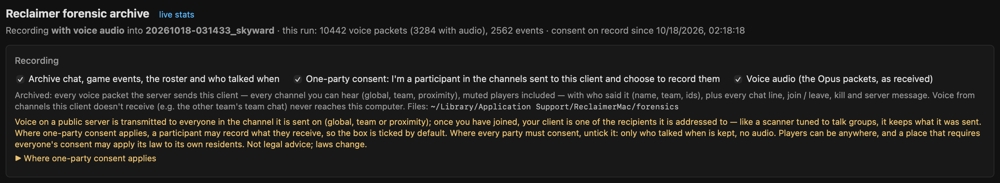
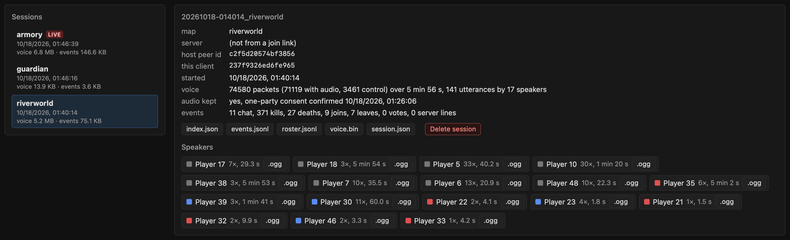
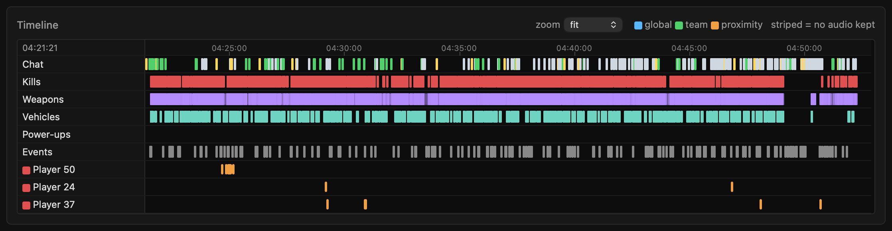
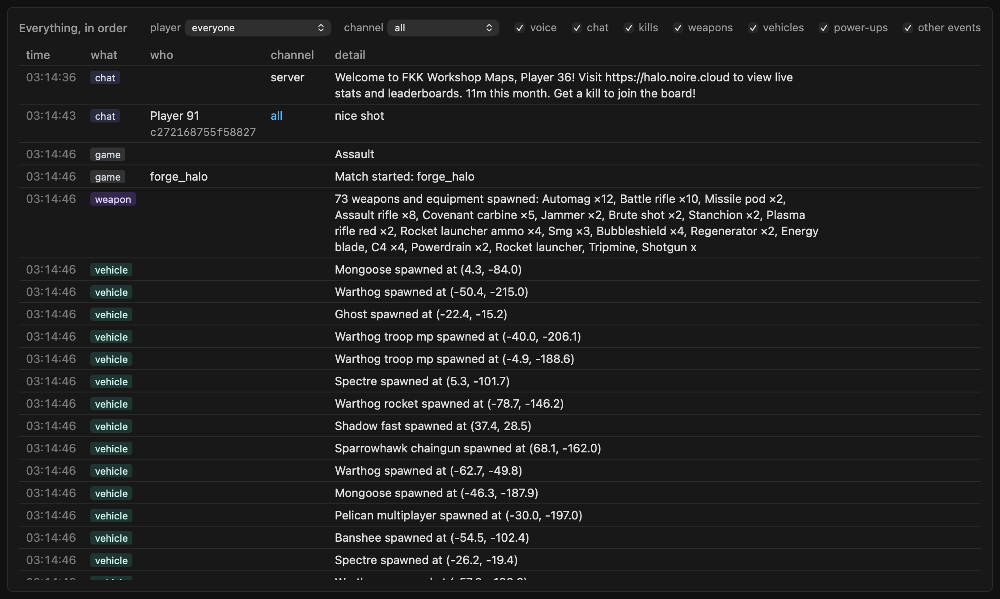

# Forensic archive of voice, chat and game events (+ viewer)

`shim/src/forensic.c` (included by peload.c right after stats.c) keeps an archive of what this client receives from the
server it is connected to -- voice packets, chat lines, the game's event feed and who was in the session -- so abusive or
cheating players can be documented afterwards. The viewer is `http://127.0.0.1:8765/forensics` (linked at the top of
the stats page). Written 2026-10-18 (backlog 43); tested offline ("Testing") and live in public Big Team Battle matches
("Verified live").

## What it looks like

*Screenshots: a session archived by a test client in a live public Big Team Battle match (Capture the Flag on
Valhalla, 17 speakers), player names, ids and chat anonymized by the page's demo mode (`?demo=1`).*

The header and the **Recording** settings: what is being recorded into which session, this run's counters, the consent
on record, the three switches (see "Consent" and "Settings and switches") and where the files are.



The **sessions** (LIVE = being written) and the selected one: map, server, host and this client's peer ids, start and
end, voice and event counts, the raw files to download, and every **speaker** with team colour, how often and how long
they talked, and all their audio as one `.ogg`.



The **timeline**: chat, kills, weapons, vehicles, power-ups and other events as ticks, then a lane per speaker with a
block per utterance (blue global, green team, orange proximity, striped = no audio kept); click a block to play it.
**Weapons** (violet), **Vehicles** (teal) and **Power-ups** (pink) are the spawn events (stats.c `st_spawns`, backlog
47): a spawn is a dim tick, a pickup a bright one, the match start's weapons one wide tick; hover a tick for the item,
the player and where (x, y and height).



**Everything, in order**: voice, chat, kills, spawns and events in one list with filters (player, channel, kinds:
voice, chat, kills, weapons, vehicles, power-ups, other events); each voice row has play, its `.ogg` and its decoded
packets; a spawn row says what, where ("Wraith spawned at (-38.5, -25.2)") and, for a pickup, who.



`/forensics?demo=1` shows every player as "Player 1", "Player 2", ... (numbered per session; the same alias everywhere
on the page, event texts included), fake peer / sender ids, placeholder chat lines and the default archive folder, for
screenshots; a session without spawn events (archived before they existed) gets a few made-up ones -- a match-start weapon
line, vehicles, power-ups, pickups by the session's aliased players -- so the Weapons / Vehicles / Power-ups lanes show;
without `?demo=1` nothing changes. A speaker's `.ogg` download doesn't work in demo mode (its URL carries the
real id). `bash shim/tools/pageshot.sh` remakes these pictures from a running game.

## What is and is not captured

- **Only what is addressed to this client.** Voice: every packet the client's own `voice_recv` (exe+0x684080 in 0.9.18,
  found by signature, stats.c `st_on_voice`) is handed. The hook runs at the function's entry, BEFORE the client's own
  checks, so packets from players this client has muted, packets for channels it would not play and its own echo are
  archived too. Chat: every line the client's chat panel gets (`TextChat::push_history`, stats.c `st_on_chat`), with the
  sender's peer id. Events: every line of the stats page's event feed (stats.c `st_event`): joins, leaves, kills and
  deaths, votes, `[SERVER]` lines, chat notices, match start / end, and spawns: weapons, equipment, vehicles and power-ups
  appearing on the map (with position), weapon pickups and power-ups taken.
- Nothing is sent anywhere; nothing is read from other processes or the network beyond what the client already gets.
- **The server relays voice and picks the listeners** (static analysis of the 0.9.18 client, 2026-10-18; the dedicated
  server is the same code). Each client sends its voice once, to the host. The host's voice_recv (exe+0x684080) forwards a
  packet to each member for whom `audible(sender, recipient, channel)` (exe+0xb25d30, called at exe+0x684da5) is true,
  one MCV1 datagram per recipient (recipient id at +0x1c): global = everyone, team = the same team, **proximity = both
  alive and less than 10 world units apart** (about 30 m; gain = clamp((10 - d) / 7.5, 0, 1), exe+0xb256a0; positions =
  each player's unit origin from the host's own simulation). So a client gets proximity voice only from speakers within
  10 units of it, and never the other team's team channel. There is no client-side filter before our hook -- nothing to
  remove locally: the archive already keeps everything this client is sent (a 128-player Forge World session held 3,284
  proximity packets from 6 speakers; the FKK BTB sessions none). Servers announce what they allow in the channel-0
  control packets (archived): mask bit 2 = proximity on (codes 0x84-0x87, 0x8c-0x8f, or the legacy 1-4); config keys
  `voice`, `voice_global`, `voice_team`, `voice_proximity`, `voice_proximity_only`, `voice_team_only`.
- **Everything, every distance: only on a host we run.** In a game this loader hosts (menu Host Game, or
  `shim/dedicated.sh` with `DED_VOICE=1`, `voice_proximity = true` and `DED_ENV=PELOAD_STATS_HTTP=<port>`), the hooked
  voice_recv is the HOST's: it receives every client's voice -- all channels, all distances, server-muted senders too --
  before the relay filter. Not tested yet. Recording other players' conversations you are not part of is outside the
  one-party-consent reasoning above (announce it, e.g. in the server's welcome lines; not legal advice).
- Voice audio is the Opus bytes exactly as received (no decoding, no re-encoding). It is only stored with the **voice
  audio** switch on, which requires the **one-party consent** box (below). Without it the archive still keeps who talked
  when: time, sender, channel, sequence, packet length and the Opus TOC byte(s) (mode / bandwidth / frame size), but no
  audio.
- Needs the stats server (`PELOAD_STATS_HTTP`, on by default in play.sh and quiet-run.sh): its hooks feed the archive and
  its 100 ms snapshot thread supplies the roster. Only the process that loads halo3.dll archives.

## Consent

Voice on a public server is transmitted to everyone in the channel it is sent on (global, team or proximity); once the
client has joined, it is one of the recipients the packets are addressed to -- like a scanner tuned to talk groups, it
keeps what it was sent and nothing else. Where one-party consent applies, a participant may record what they receive;
where every party must consent, voice audio should stay off (only who talked when is kept). Players can be anywhere, and
a place that requires everyone's consent may apply its law to its own residents; whether in-game voice counts as a
private conversation can vary. Not legal advice; laws change -- check the current statutes.

Where one-party consent applies (as commonly cited, 2026):

- **United States, one-party:** federal law (18 U.S.C. 2511(2)(d)), District of Columbia, Alabama, Alaska, Arizona,
  Arkansas, Colorado, Georgia, Hawaii, Idaho, Indiana, Iowa, Kansas, Kentucky, Louisiana, Maine, Minnesota, Mississippi,
  Missouri, Nebraska, New Jersey, New Mexico, New York, North Carolina, North Dakota, Ohio (Ohio Revised Code 2933.52),
  Oklahoma, Rhode Island, South Carolina, South Dakota, Tennessee, Texas, Utah, Vermont (no statute), Virginia, West
  Virginia, Wisconsin, Wyoming.
- **United States, mixed:** Connecticut (one-party in person, all-party for calls), Michigan (participants may record
  their own conversations), Nevada (one-party in person, all-party for calls), Oregon (one-party for calls, all-party in
  person).
- **United States, every party:** California, Delaware, Florida, Illinois, Maryland, Massachusetts, Montana, New
  Hampshire, Pennsylvania, Washington.
- **Elsewhere, commonly treated as one-party / a participant may record:** Canada, the United Kingdom, Ireland, New
  Zealand, Israel, South Africa, Japan, the Netherlands, Denmark, Sweden, Norway, Finland, Italy, Spain, Brazil, India.
  Australia differs by state (Victoria, Queensland and the Northern Territory one-party; the others stricter).
- **Stricter** (recording a private conversation without everyone's consent is an offence): e.g. Germany, France,
  Switzerland, Austria.

The user is in a one-party place (2026-10-18), so:

- with no `settings.json` yet, one-party consent and voice audio start ON (the time is recorded as the confirmation);
  unticking "One-party consent: I'm a participant in the channels sent to this client and choose to record them" on the
  viewer page turns voice audio off (only who talked when is kept); ticking it again asks for confirmation;
  `PELOAD_FORENSIC_AUDIO=0|1` overrides voice audio for one run;
- persists the confirmation with its time (`one_party_consent: true`, `consent_confirmed_unix`) in
  `forensics/settings.json` and copies it into each session's `session.json`;
- refuses `voice=1` without consent on record; withdrawing consent turns voice audio off at once;
- notes every setting change in the running session's `events.jsonl` (kind `archive`).

Text, events, the roster and voice metadata (who talked when, no audio) are archived by default; the "Archive" switch
turns all of it off.

## Settings and switches

| | |
|---|---|
| page: Archive | text + events + roster + voice metadata. Default ON. `POST /control?do=forensic&archive=0\|1` |
| page: One-party consent | `POST /control?do=forensic&consent=1` (records the time) / `consent=0` (also turns voice audio off) |
| page: Voice audio | `POST /control?do=forensic&voice=0\|1`; `voice=1` is refused without consent (`consent=1&voice=1` in one request works) |
| page: Delete session / Delete selected | `POST /control?do=forensic&delete=<session>` (one request per checked session): the folder and its files; a live session is closed first, recording continues in a new one |
| page: Clear all | `POST /control?do=forensic&delete=all`: every session folder (a name with `_` and a `session.json`; other folders and `settings.json` stay) |
| `PELOAD_FORENSIC=0` | disables recording entirely (the viewer still shows old sessions) |
| `PELOAD_FORENSIC_DIR=<dir>` | archive somewhere else (default `$HOME/Library/Application Support/ReclaimerMac/forensics`) |
| `PELOAD_FORENSIC_PAGE=<file>` | serve the viewer from disk; with `PELOAD_STATS_PAGE` set (play.sh does in a checkout) `forensic_page.html` next to it is served, so page edits show on a refresh |

`/control` needs POST with an `X-Reclaimer-Control` header like every stats page control; `PELOAD_STATS_READONLY=1`
turns all controls off. Settings are in `forensics/settings.json`:
`{"archive":true,"voice_audio":true,"one_party_consent":true,"consent_confirmed_unix":<first start>,"consent_confirmed":"<iso time>"}` (the defaults).

Cost: with the archive off, each hook (voice, chat, event) does one flag check (`g_fx_on`) and the snapshot thread one
more; the writer thread is not even started. With it on, a hook copies its record into an in-memory queue under one
short lock (no file I/O, no allocation in the steady state); the `shim-forensic` thread writes the queue out once a
second (sooner past 4 MB). Up to 64 MB can wait in the queue; past that new records are dropped and counted (the page
shows the count). Files are flushed every second, so a crash loses at most the last second; `session.json`'s
`ended_unix` stays null when the process dies (the viewer then uses the last record's time).

## Sessions

`forensics/<YYYYmmdd-HHMMSS>_<label>/`, local time, label = the map (the stats page's map name, e.g. `riverworld`), else
the server from a `reclaimer://join?server=<host:port>` launch (play.sh `RECLAIMER_JOIN`), else `lobby`. A new session
starts when, stable for 2 s (map loads flicker):

- the network session's **host peer id** changes (another server, or a new session on the same one); map changes
  within one server stay in its session -- every roster line carries the map (2026-10-18: keying on the map as well
  split the main menu into a session per background scene: guardian, 005_intro, ...);

the current one also closes when the client has been out of any session for 5 s. Records that arrive with no session
open (rare: a notice in the main menu) open a `<time>_menu` session. A server joined from the Server Browser has no
address in its session (the client logs none the loader taps); its host peer id identifies it across sessions.

## Files

All integers little-endian. Peer ids are the 8-byte Halo network-session peer ids the client also uses as voice ids
(reclaimer-voice-mute.md section 4), written as 16 hex digits.

### voice.bin

Control packets (channel byte 0) are kept at most once per sender per 50 ms; the rest are only counted (`counters.
control_not_kept` in the live status). Public servers send about one per player per 100 ms; our own local dedicated
server sent ~23,700 a second on 2026-10-18 (1,053,203 records in 44 s) -- an open question (backlog 51).

Header, 64 bytes:

| off | type | |
|---|---|---|
| 0 | char[8] | `"RCVOICE\0"` |
| 8 | u32 | version = 1 |
| 12 | u32 | header size = 64 |
| 16 | u64 | created, unix ns |
| 24 | u64 | this client's peer id when the file was made (0 = not known yet) |
| 32 | u32 | record header size = 40 |
| 36 | u32 | flags: bit 0 voice audio was on at creation |
| 40 | 24 bytes | 0 |

Then one record per packet, append-only: a 40-byte header followed by `stored` bytes.

| off | type | |
|---|---|---|
| 0 | u16 | sync `0xA55A` |
| 2 | u8 | channel = payload[0]: 1 global, 2 team, 3 proximity, 0 control (below); 0xFF unreadable |
| 3 | u8 | flags: 1 audio stored, 2 control packet, 4 truncated (stored < length; never in practice), 8 shorter than the 9-byte header (raw bytes stored with audio on), 16 from this client's own peer id (echo), 32 payload unreadable |
| 4 | u16 | length of the Opus data (payload length - 9) |
| 6 | u16 | stored bytes that follow (= the length with audio on; 0 without; control packets: their bytes) |
| 8 | u64 | arrival time, unix ns (CLOCK_REALTIME, taken in the hook) |
| 16 | u64 | sender peer id (voice_recv's rdx) |
| 24 | u64 | sequence = payload[1..9] as u64 LE |
| 32 | u8, u8 | payload[9] and payload[10]: the frame-count byte (see below) and the Opus TOC byte (packet duration even without audio) |
| 34 | 6 bytes | 0 |

**Voice payload (live, 2026-10-18):** `[0]` channel, `[1..9]` sequence (u64 LE), `[9]` a frame-count byte -- 1 in all
22,091 audio packets of a live BTB session -- then ONE Opus packet (TOC 0x48 there: SILK wideband, 20 ms, mono, 50
packets a second, ~20 kbit/s). The stored bytes are payload[9..] exactly as received; the readers skip the count byte
when it is 1 (the first version decoded from it: garbled playback, half the packets invalid Opus). Verified: 250 live
packets re-wrapped decode in ffmpeg with no error to exactly 5.0 s.

A reader that meets a bad sync (a torn write) scans forward to the next record with a valid sync, a sane length and a
time within a day before / 40 days after the header's creation time (the viewer counts them as `bad_records`); an
incomplete last record is simply not read yet.

Payload facts, CONFIRMED in voice_recv (0.9.18): audio packets are accepted with a total length of 11..650 bytes
(exe+0x684138: 2..641 bytes of Opus) and channel 1..3 (exe+0x684153); the sender's own echo is dropped
(sender == voice state +0x278 -> +0x9c0); the per-sender stream drops a packet whose sequence is <= the last accepted
one, compared as an unsigned u64 (exe+0xb2ca4d, `cmp rdx,[rcx+8]; ja`), so the sequence is a little-endian, strictly
increasing counter per sender. Whether it counts packets (+1 each) is GUESSED: the viewer only reports `seq_gaps`
(missing packets) for an utterance whose smallest step is 1. Channel-0 packets (exe+0x684248): only accepted from the
peer id at voice state +0x1e8 (GUESSED: the server / voice host), exactly 10 bytes: [1..9] their own sequence, [9] a
code 0..4 or 0x80..0x8f that sets two fields of the voice state (+0xafa bit, +0xafc mask: codes 0..4 -> masks
0,7,7,4,4; GUESSED: which channels the server allows). They are archived with flag 2 and their code byte, whether or
not voice audio is on (they are not audio).

Python reader:
```python
import struct
d = open('voice.bin', 'rb').read(); assert d[:8] == b'RCVOICE\0'
hs, rs = struct.unpack_from('<I', d, 12)[0], struct.unpack_from('<I', d, 32)[0]; o = hs
while o + rs <= len(d):
    sync, ch, fl, olen, slen, t, sender, seq, toc = struct.unpack_from('<HBBHHQQQB', d, o)
    if sync != 0xA55A: break                      # (resync as described above)
    opus = d[o + rs:o + rs + slen]; o += rs + slen
    print(t / 1e9, '%016x' % sender, ch, seq, olen, 'audio' if fl & 1 else '-')
```

### roster.jsonl

One line whenever the session's member list (id, name, team, slot, host / self, muted) or the map changes, and the
first one of every session:
```json
{"t":1760760000.123,"map":"riverworld","host_peer":0,"host_id":"9e3...","self_peer":3,"self_id":"41c...",
 "members":[{"id":"1111111111111111","name":"Alice","peer":1,"index":0,"slot":0,"team":1,"team_name":"blue",
             "host":false,"self":false,"muted":false}]}
```
`members` = the halo3 network session (stats.c `st_session`: player records with a peer index, peer id, UTF-16 name),
paired with the engine's players table the way the stats page pairs them (session index == player slot and the same
name, else the name). `team` is the last team seen on the player's biped (-1 before it spawned). `muted` is this
client's own mute list. `host_id` / `self_id` are the host's and this client's peer ids (a dedicated server is a host
peer without a player).

### events.jsonl

One line per event, in arrival order: `t` (unix seconds), `seq` (the stats feed's sequence), `kind` (chat, join, leave,
kill, death, vote, server, game, log, archive, weapon, vehicle, powerup), `text`, and when present `a` / `b` (killer,
victim; chat: sender name; a pickup: the player), `how` (weapon; a spawn: the item), `verb` (kills; spawns: `spawned` /
`picked up`), `ta` / `tb` (teams), `estimated`, `mine`, `betrayal`, `pos` (`[x, y, z]`: where an item spawned, or
where a power-up was taken). Chat lines also carry `channel` (all, team, nearby, server, notice) and, for players'
messages, `sender_id` (Line +0x30, the sender's peer id). Spawn lines, e.g.:
```json
{"t":1760790000.512,"seq":88,"kind":"vehicle","text":"Wraith spawned at (-38.5, -25.2)","how":"Wraith","verb":"spawned","pos":[-38.48,-25.19,-4.66]}
{"t":1760790000.512,"seq":89,"kind":"weapon","text":"14 weapons and equipment spawned: Battle rifle x4, Sniper rifle x2, ...","verb":"spawned"}
{"t":1760790031.104,"seq":97,"kind":"powerup","text":"Bob picked up Overshield","a":"Bob","how":"Overshield","verb":"picked up","ta":1,"pos":[0.42,12.87,-2.35]}
```
Sessions archived before the spawn events existed (2026-10-18) have none; the first weapon-only version (that day) wrote
upper-case names ("SNIPER RIFLE") and "spawned at x, y, z" without `pos` -- the viewer reads both.

### packets.jsonl

The packet log's per-second sums (shim/src/pktlog.c; the live view is the stats page's Packets window). Once a second,
while the archive is on and the client is in a server's session (menu time is not archived): one line per (layer,
direction, type, peer) that had records in that second -- `layer` (`wire`: UDP datagrams and TCP connections on the game's
sockets; `game`: halo3's own message types, only when the stats page's "halo3 message types" switch is on), `dir` (`tx` /
`rx`), `type`, `n` (records), `bytes` (wire only: datagram sizes; for `tcp-close` the bytes the connection carried),
`t0` / `t1` (the first / last record's time), and when known `peer` (`ip:port`) and `host` (the name it was looked up
by). A `{"t":..,"lost":n}` line = records overwritten in the ring before they were summed (a very busy second).
```json
{"layer":"wire","dir":"tx","type":"quic-1rtt","n":78,"bytes":5074,"t0":1792890001.004,"t1":1792890001.990,"peer":"127.0.0.1:49190"}
{"layer":"game","dir":"rx","type":"membership-update","n":1,"bytes":0,"t0":1792890001.512,"t1":1792890001.512,"peer":"host","peer_id":"8f3c0e5a1d6b7290","via":"channel","peer_no":0}
```
Wire types, read from the datagram's first bytes without decrypting anything: `quic-initial` / `quic-0-rtt` /
`quic-handshake` / `quic-retry` (a QUIC long header, RFC 9000 17.2; another version adds `v<hex>`, QUIC v2 is `quic2-*`),
`quic-version-neg`, `quic-1rtt` (a short header: the connected state, where nearly all game traffic is), `tag XXXX` (a
plaintext four-character tag: hole punching, relays), `tcp-connect` / `tcp-close`. Flags (the live window shows them):
`spin` (a short header's spin bit -- the only bit header protection leaves visible; an endpoint that doesn't measure with
it sets it at random, RFC 9000 17.4) and `greased` (the fixed bit is 0: both ends offered grease_quic_bit, RFC 9287, as
the client's QUIC library does). Game types are halo3's message names (46: ping, connect-request, join-request,
membership-update, player-add, time-synchronize, view-establishment, ...), counted as halo3 encodes one to send it
(`tx`) or decodes one it received (`rx`), per session peer: `peer` = the player's name (`host` = a host without a player,
such as a dedicated server; `peer N` = a peer without a player yet; `peer <id>` = an id the session no longer had when the
line was written), `peer_id` = halo3's session peer id (the same id as the roster's and the voice packets'), `peer_no` =
its session peer index, `via` = `gateway` (connectionless messages: connect, join, ping) or `channel` (a connected
peer's). How the peer is found: pktlog.c "the peer of a halo3 message".

### session.json

Name, label, map, server, host / self peer ids, start (unix + local ISO time), end (null while open or after a crash),
pid, and the voice-audio / consent state when the session started.

## Viewer and endpoints (GET)

| path | |
|---|---|
| `/forensics` | the page (shim/src/forensic_page.html, embedded) |
| `/forensics/sessions.json` | settings, recording state, counters, the archive directory, every session (newest first) with sizes and its session.json |
| `/forensics/<s>/index.json` | the session: `utterances`, `speakers`, `people` (everyone the roster listed), `control` packets, `events`, stats |
| `/forensics/<s>/utt/<n>.ogg` | utterance n as Ogg Opus (404 when it has no audio) |
| `/forensics/<s>/utt/<n>.json` | its packets: time, sequence, length, stored, TOC decoded (mode, bandwidth, frame ms, stereo, code, duration) |
| `/forensics/<s>/speaker/<peer id>.ogg` | all of one sender's audio in the session (`.json`: their packets) |
| `/forensics/<s>/events.jsonl`, `roster.jsonl`, `voice.bin`, `session.json`, `packets.jsonl` | the raw files |

`?dl=1` adds `Content-Disposition: attachment`. Ogg replies honour `Range: bytes=` (206 / 416) and are byte-identical
on every request (Safari's player asks for ranges). A session being written is flushed before it is read, and its
voice.bin is read incrementally (only the new tail) on each refresh.

**Utterance** = a run of packets from one sender on one channel whose arrival times are less than 0.6 s apart. `start`
= the first packet's arrival, `end` = the last packet's arrival + its duration, `audio_s` = the summed packet durations.
Each utterance is attributed to the roster entry in force at its start (name, team, slot), so a later rename or team
change does not rewrite history; `speakers[].names` lists every name an id had.

**Ogg files.** OpusHead version 1, channel count from the first packet's TOC stereo bit, pre-skip 0 (nothing the
client received is dropped), input rate 48000, gain 0, mapping family 0; OpusTags with the speaker, peer id, session,
channel and start time; audio pages of whole packets, about one second each, granule = samples through the page's last
packet (from each packet's TOC: config -> frame duration, code 0/1/2/3 -> frame count), CRC-32 polynomial 0x04C11DB7,
EOS on the last page. Packets are never re-encoded. A **speaker file** keeps each utterance's packets back to back and
puts the gap between two utterances in as silence, shortened to at most 1 s (`F8 FF FE`, a 20 ms CELT silence frame),
so it plays as one recording of everything that person said; the index has the real times.

The page: the session list (LIVE = being written), a summary with downloads, speakers with team colours and their
`.ogg`, a timeline with one lane per speaker (blue global, green team, orange proximity, striped = no audio kept) plus
chat / kill / weapon / vehicle / power-up / event lanes, and everything in one list in time order with filters (player
by peer id, channel, voice / chat / kills / weapons / vehicles / power-ups / other events), and a Packets panel:
packets.jsonl summed per type and peer for the whole session, under a per-second strip (orange datagrams sent, green
received, blue ticks = seconds with halo3 messages). Click a voice block or "play" to listen; "packets" shows the decoded packets. The live
session refreshes every 5 s. Each session row has a checkbox (kept across the refresh): "Delete selected (n)" removes the
checked sessions, "Clear all" every session, "Delete session" (summary) the open one -- each asks for confirmation first.

## Testing

`bash shim/tools/forensic-oggtest.sh` (offline, no game; needs ffmpeg with libopus + python3) builds
`shim/tools/forensic-oggtest.c`, which compiles forensic.c with `FX_TEST=1` (everything except the engine glue):

1. ffmpeg encodes tones to Ogg Opus in 8 shapes (CELT 2.5/10/20 ms, stereo 40 and 60 ms = code 1/2/3 packets, 120 ms,
   SILK voip at 10-12 kbit/s); the harness re-wraps the raw packets with the writer, reads them back (our CRC agrees
   with ffmpeg's pages, packets byte-identical, granules), and ffmpeg decodes ours without a single message to the
   exact expected sample count, bit-identical to its decode of its own file (up to that file's end-trimmed last frame).
2. 50 silence frames decode to 1 s of zeros.
3. The archive end to end: consent refused / accepted / persisted, roster lines, 4 speakers' packets with a pause, a
   missing sequence number, a control packet, a malformed packet, our own echo, voice audio switched off mid-session,
   chat with sender id, a torn record followed by more packets, a map change (debounce, a second session; the test predates the host-only key) -- then every
   endpoint over a socketpair: names / teams at the time, Range requests, 404s, and every .ogg served decodes cleanly to
   the expected length; every JSON reply parses. Deletes: bad / missing names refused, `delete=<session>`, `delete=all`
   (folders that aren't sessions stay).

`forensic-oggtest serve <in.ogg> <dir> <port>` serves that test archive on 127.0.0.1:<port> to look at the page
(`PELOAD_FORENSIC_PAGE=<abs path>/shim/src/forensic_page.html` serves the checkout's page, so edits show on a refresh).

## Verified live (2026-10-18, public Big Team Battle matches)

- The hook receives payload and length: 9,000+ voice packets per session archived, every audio packet decodes.
- The payload: `[0]` channel, `[1..9]` sequence (u64 LE, steps by exactly 1 per sender, no gaps), `[9]` a frame-count
  byte (1 in all 22,091 packets of one session), then one Opus packet (SILK wideband, 20 ms, mono, ~20 kbit/s). The first
  viewer decoded from the count byte (garbled playback); fixed in the readers.
- Control packets (channel 0) come from one id every ~100 ms (the voice server, GUESSED).
- Session boundaries: one session per server (host peer id) across map changes (the first version also split on the
  map, so the menu's background scenes each opened a session).
- What arrives: global voice from both teams; team-channel voice only from this client's own team (zero packets from the
  other team in two sessions, which did talk on global); no proximity packets seen. So the other team's team voice is
  dropped upstream (server or sender), not by this client -- the archive records before the client's own filtering.

## Not verified yet

- The host-side archive (every channel and distance) in a game we host: built in, not run yet.
- The chat sender id (Line +0x30) on received lines (the viewer shows ids next to chat senders; not cross-checked).
- Playback of the page's Ogg files in Safari (the test browser played them; Safari's Ogg Opus support depends on its
  version -- the page says so and offers downloads when `canPlayType` says no).
