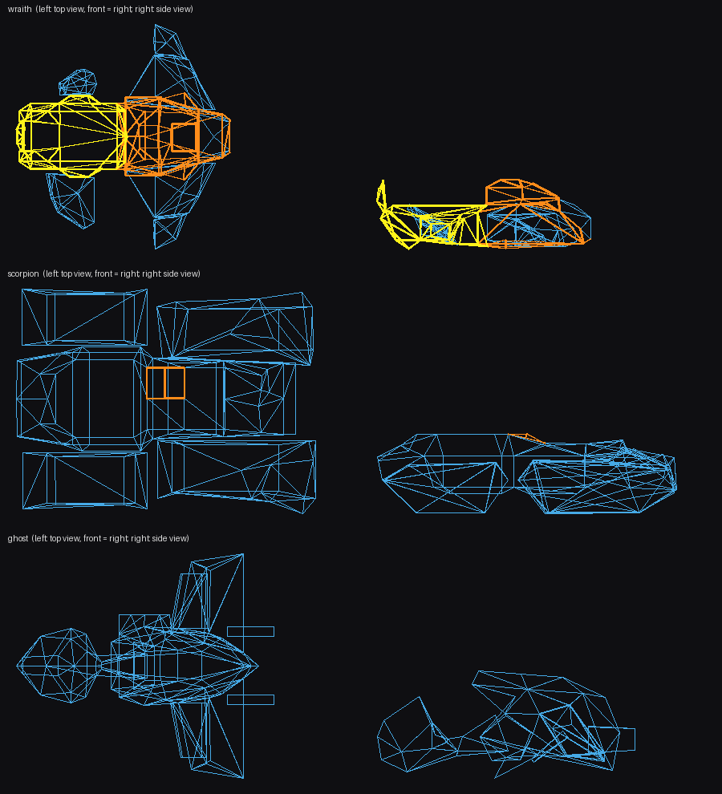
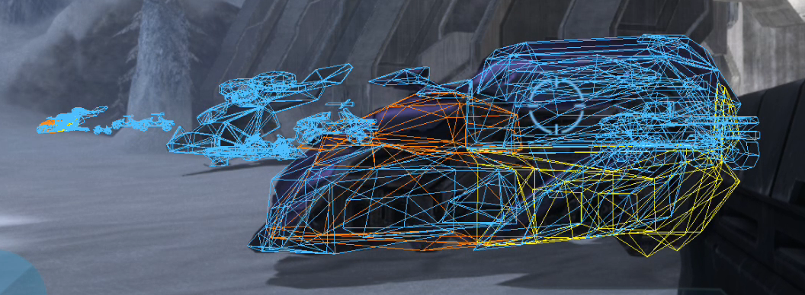

# halo3.dll (MCC) runtime object layout

Found 2026-10-16 from the evaluate functions of halo3's own HaloScript getters (`re-tools/hsfuncs.py` lists a
script function's table entry: return type, name, parse and evaluate functions, parameter types) and from
datums observed live. Offsets are from the object datum (object table entry +0x10).

## Finding objects
- Static-TLS index of halo3: `halo3+0xa39f9c`; thread-local block = `gs:[0x58][index]`.
- Object table: data array "object" at TLS block +0x38 (header: +0x20 max, +0x24 element size 0x18,
  +0x2c 'd@t@', +0x3c high-water, +0x48 data). Entry (0x18 B): +0x00 salt (0 = free), +0x03 type,
  +0x10 datum pointer. Handle = salt << 16 | index.
- Players: data array at TLS block +0x10 (`player_active_camouflage_on` iterates it); player datum +0x28 = the
  player's unit handle.
- Types: 0 biped, 1 vehicle, 2 weapon, 3 equipment, 5 projectile, 6 scenery, 10 crate, 11 creature, 12 giant,
  13 effect scenery.

## Every object
| Offset | Field | Source |
|---|---|---|
| +0x00 | definition tag (datum index) | |
| +0x10 | parent object handle (the vehicle when seated, the holder for a held weapon) | `unit_in_vehicle` |
| +0x1c | bounding-sphere centre; +0x28 radius | observed |
| +0x50 | origin (feet for bipeds) | observed |
| +0x5c / +0x68 | forward / up vectors | `object_set_velocity` |
| +0x74 / +0x80 | velocity / angular velocity | object_set_velocities (halo3+0x341110) |
| +0xF4 | health (body vitality, 1.0 = full) | `unit_get_health`, `object_get_health` |
| +0xF8 | shield vitality (1.0 = full, more with overshield) | `unit_get_shield` |
| +0x110 | flags; bit 2 set -> health and shield read as 0 (dead) | same getters |
| +0x136 | node matrices block reference {u16 size, u16 offset}; real_matrix4x3 (scale, fwd, left, up, pos) per node | observed |
| +0x13A | region permutations block reference {s16 size, s16 offset}: count = (size - (+0x4 bit 11 ? 0x20 : 0)) / 10; per region 8 bytes of state, then one permutation byte per region at offset + count*8 (indexes the model's Collision Regions[r].Permutations) | object_set_permutation (halo3+0x3457d8, +0x345d38) |

## Tags in memory
`object_set_permutation` also shows the engine's own tag lookup: tag table = `*(u64*)(halo3+0xA49018)`, 8-byte
entries, u32 address at +4; tag pointer = `*(u64*)(halo3+0x1FCF4C8)` + address*4. Object definition +0x40 = model
tag datum; model (hlmt) +0xA0 Collision Regions[0x14] { +4 collision region, +8 Permutations[8] { +5 collision
permutation } }.

## Units (biped / vehicle / giant)
| Offset | Field | Source |
|---|---|---|
| +0x174 | team index | `unit_get_team_index` |
| +0x24E | seat index (s16, -1 = not in a vehicle) | `unit_in_vehicle` (halo3+0x3a36f4) |
| +0x262 | current weapon slot (s8) | `unit_get_primary_weapon` |
| +0x268 | weapon object handles [4] (the overlay's player label shows the slot +0x262 one, then " / " the first other one carried) | halo3+0x356388 |
| +0x294 | grenade counts [4] (s8: frag, plasma, spike, firebomb) | `unit_get_total_grenade_count` |
| +0x360 | active camouflage amount (float; > 0 = camo active) | `player_active_camouflage_on` |
| +0x1A0, +0x1AC, +0x1C4, +0x1D0 | aiming / looking vectors (unit vectors; all equal the camera forward for the local player in 100% of samples over a 15 degree pitch sweep) | recorded live (PELOAD_HB_SELFDUMP) |
| +0x384 | crouch amount (float: 1.0 crouched, 0 standing) | recorded live: 1.0 exactly while crouch was held |

Verified live with a scripted self-grenade (2026-10-16): grenade counts 2 -> 1 -> 0 as thrown; shield 1.0 -> 0 and
health 1.0 -> 0.82 from the blast; after respawning, a new unit (handle changes in the player record) with full
health/shield and 2 grenades.

## Players
Data array at TLS block +0x10, element 0x2F8 bytes (Slayer, 2 slots in a 2-player game).
| Offset | Field | Source |
|---|---|---|
| +0x28 | unit handle (changes on respawn) | `player_active_camouflage_on`; recorded |
| +0x4C | position (3 floats) | recorded |
| +0x58 | nickname (UTF-16) | recorded ("Shiz") |
| +0x294 | increments on respawn (lives used / spawn count) | recorded |
| +0x1F0 | betrayer player handle (the boot-betrayer popup reads it) | static RE (CLAUDE.md "Betrayal popup") |
| +0x1FC | resolved active traits, recomputed every tick | halo3-variant-traits.md |

Local player: player mapping at TLS block +0x110, output user 0 -> player handle at +0xB8 (stats.c, hitbox.c).
Kills / deaths / score: not in the player record (no field changed on a suicide except the respawn ones). The loader
gets exact kills from an entry hook on halo3's display_event (halo3+0x11b0ec; shim/docs/halo3-event-feed.md) and
deaths from any biped going alive -> dead (+0x110 bit 2); the scoreboard's own score fields are not located.

## Projectiles
| Offset | Field | Source |
|---|---|---|
| +0x1b0 | distance travelled | bullet datums at deletion |
| +0x1dc | speed | same |
| +0x1e8 | start position (where it was fired from) | same |
| +0xC0 | owner unit handle (the shooter) | bullet datum = the firing player's unit (player record +0x28) |

Most bullets (e.g. the assault rifle's) are created and deleted inside one engine tick, so they never appear in
the object table between frames. `object_delete` (halo3+0x342ed8, handle in ecx) sees them: the loader hooks its
entry (`hbdel_install`) and records projectile datums; at deletion +0x1c is the impact point.

## Still to confirm
The engine's score statistics; objective state (flags, territories, hills; needs an objective game variant to observe).

## Vehicle weak spots: the model's damage info (2026-10-17, backlog 31)

Static, from the .map (re-tools/h3dmg.py <map> prints it; the overlay's hbg_weak in shim/src/hitbox.c uses the same rule).
Layouts: Assembly Halo3MCC hlmt.xml / coll.xml.

In the overlay (Vehicles on, 2026-10-17/18): vehicle hitbox edges are cyan; edges whose collision material maps
to a lethal section (class 2: a section smaller than the body whose response kills or destroys it) are yellow, to the
cheapest section that opens a shielded seat at "major" (class 1) orange, to a section under half the body whose response
damages a gun trigger, the steering or the engine or forces a weapon drop (class 3, instant response flags bits 4, 8-15;
2026-10-18) magenta. Stats page chips under the Vehicles button: POST `/control?do=weaktype&t=1|2|4`,
`PELOAD_HB_WEAK_SHOW=<mask>` (default 7; 1 = lethal, 2 = driver, 4 = disables). The rule runs on EVERY vehicle definition
(turrets and mounted guns are vehicles too) of the map being played; the `[hitbox] definition ...` log line counts each
model's weak-spot edges per class. Verified live 2026-10-18 on Avalanche: Wraith back hatch yellow, cockpit orange, the
Scorpion's driver hatch orange, Warthogs cyan (img/overlay-weakspots.png).

- object def (vehi/bipd) +0x34 model tagref -> hlmt. hlmt +0x7C Materials [0x14] (+0 name sid, +6 s16 damage section),
  +0x88 New Damage Info [0xA4], +0x94 Targets [0x20] (aim/lock-on markers: +0xC section, +0x18 flags bit 2 headshot,
  bit 3 vulnerable), +0xA0 Collision Regions.
- New Damage Info: +0xC body vitality, +0x20 shield vitality, +0x68 Damage Sections [0x2C] (+0 name, +4 flags: bit 0
  absorbs body damage, 7 headshotable, 8 ignores shields; +8 share of body vitality; +0xC Instant Responses [0x88]:
  +8 flags (bit 0 kills, 7 destroys, 16 kills except solo, 23 only on special death), +0xC threshold, +0x40 region sid,
  +0x44 new state 0-4, +0x78 ejected seat), +0x8C Damage Seats [0x20] (+0 seat label, +4 direct damage scale = share of a
  hit on the rider that reaches the rider, +0x14 region-specific [0x2C]: +0 region, +8/+0x14/+0x20 direct scale at
  minor/medium/major damage).
- A hit's section: collision surface (coll region/permutation/bsp +0x40 surfaces [0xC], material s16 at +4) -> coll +0x14
  materials (name sid) -> the hlmt material with the same name -> its section. Section damage also counts against the body
  unless the section absorbs it; parts (fenders, wings, rudders) only change damage states.
- String ids in these builds: 19-bit index, namespace at bit 19; namespace-0 indices past namespace 0's count continue
  after all namespaced strings (re-tools/h3bsp.sid_name; h3map.H3Map.sid gets the second part wrong).

What the stock vehicles have (Sandbox, every MP vehicle): Wraith back hatch / rear engine section = 10% (75 of 750): its
response KILLS the Wraith. Wraith cockpit (15%, 113) and Scorpion driver hatch (15%, 113): at "major" the driver's direct
damage scale goes 0 -> 1. Other vehicles have no lethal section; damage anywhere drains the same body pool. Riders:
Mongoose / Chopper driver 1.0, Warthog / Ghost / Mauler / gunners 0.9 (Ghost 1.0 once its hull is damaged), Banshee /
Hornet pilot 0.2-0.5 by hull state, boarding seats 1.0. The Ghost has a 5% (20) gas_tank section that kills it, but no
collision material feeds it.

(top and side views from the .map's collision models; yellow = lethal section, orange = opens the driver, blue = rest)

Disabling parts (class 3): Ghost wings (20%, 80 of 400: the gun on that side, the left one also the steering), Warthog
front fenders (15%, 75: steering; also on every Warthog variant and the Workshop treadhogs), Mongoose wheels (20%, 40:
steering). Turrets (machine-gun turret, plasma cannon, missile pod, Shade, the Warthog / Wraith / Scorpion guns) have one
damage pool and no weak part; stationary gunners take 100% of a hit, mounted gunners 80-90%.

### Every vehicle (2026-10-18; `python3 re-tools/h3dmg.py --table <maps...>` remakes this)

All 178 vehicle definitions in the stock multiplayer maps and the downloaded Workshop maps (Ultimate Forge desert_sandbox,
Hugegrass, Permafrost, HugeGrass Rebalance), first map each is found in. "Weak spots" = what the overlay colors: section:
kind (damage to that part alone); "no surface" = the section exists but no collision material feeds it, so a shot can't
reach it. "Driver takes" = the first damage seat's direct damage scale (the share of a hit on the
driver that reaches the driver; 0% = shielded until a part breaks). A "-" vehicle has one damage pool: hits anywhere count the same.

| Vehicle | Weak spots (damage to that part) | Driver takes | Maps |
|---|---|---|---|
| aa_gun_left | - | - | desert_sandbox, hugeass_remastered_mcc, hugetowers, fixedHugeGrassTrapasRemix |
| aa_gun_right | - | - | desert_sandbox, hugeass_remastered_mcc, hugetowers, fixedHugeGrassTrapasRemix |
| albatross | - | 100% | desert_sandbox, hugeass_remastered_mcc, hugetowers, fixedHugeGrassTrapasRemix |
| anti_air | - | - | bunkerworld, deadlock, riverworld, sandbox +14 |
| anti_infantry | - | 80% | armory, bunkerworld, deadlock, deadlock +27 |
| anti_infantry_anti_air_wraith | - | 80% | bunkerworld, deadlock, riverworld, sandbox +8 |
| anti_infantry_blue | - | 80% | hugetowers |
| anti_infantry_red | - | 80% | hugetowers |
| anti_infantry_snow | - | 80% | sidewinder |
| autoturret | - | - | armory, bunkerworld, chill, chillout +27 |
| banshee | - | 20% | bunkerworld, chill, construct, isolation +8 |
| banshee_ai_blue | - | 20% | hugetowers |
| banshee_ai_red | - | 20% | hugetowers |
| beam_turret_left | - | - | desert_sandbox, hugeass_remastered_mcc, hugetowers, fixedHugeGrassTrapasRemix |
| beam_turret_right | - | - | desert_sandbox, hugeass_remastered_mcc, hugetowers, fixedHugeGrassTrapasRemix |
| behemoth | - | 100% | sandbox, shrine, sidewinder, desert_sandbox +3 |
| behemoth_turret | - | 100% | sandbox, shrine, sidewinder, desert_sandbox +3 |
| bfg | - | 0% | desert_sandbox, hugeass_remastered_mcc, hugetowers, fixedHugeGrassTrapasRemix |
| bfg_ai_blue | - | 0% | hugetowers |
| bfg_ai_red | - | 0% | hugetowers |
| brute_chopper | - | 100% | armory, bunkerworld, deadlock, isolation +10 |
| cannon | - | 100% | armory, deadlock, riverworld, sandbox +8 |
| cannon_snow | - | 100% | sidewinder, hugetowers |
| chaingun | - | 90% | armory, bunkerworld, cyberdyne, deadlock +22 |
| chaingun_snow | - | 90% | s3d_turf, s3d_waterfall, sidewinder, hugetowers +1 |
| chin_gun | - | 90% | desert_sandbox, desert_sandbox, desert_sandbox, desert_sandbox +9 |
| chin_gun_blue | - | - | hugetowers |
| chin_gun_friendly | - | - | desert_sandbox, hugeass_remastered_mcc, hugetowers, fixedHugeGrassTrapasRemix |
| chin_gun_reach | - | - | hugeass_remastered_mcc, hugetowers, fixedHugeGrassTrapasRemix |
| chin_gun_red | - | - | hugetowers |
| chin_gun_searchlight | - | - | desert_sandbox, hugeass_remastered_mcc, hugetowers, fixedHugeGrassTrapasRemix |
| chin_gun_snow | - | 90% | hugetowers |
| condor_h3 | - | 0% | desert_sandbox, hugeass_remastered_mcc, hugetowers, fixedHugeGrassTrapasRemix |
| cov_defender | - | - | snowbound |
| cov_guntower | core: kills (100) | 0% | desert_sandbox, hugeass_remastered_mcc, hugetowers, fixedHugeGrassTrapasRemix |
| cov_guntower_ai_blue | core: kills (100) | 0% | hugetowers |
| cov_guntower_ai_red | core: kills (100) | 0% | hugetowers |
| drone_alpha | - | 0% | desert_sandbox, hugeass_remastered_mcc, hugetowers, fixedHugeGrassTrapasRemix |
| falcon_gl | - | 20% | hugeass_remastered_mcc, fixedHugeGrassTrapasRemix |
| falcon_mp | - | 20% | desert_sandbox, hugeass_remastered_mcc, fixedHugeGrassTrapasRemix |
| falcon_mp_gl | - | 20% | desert_sandbox, hugeass_remastered_mcc, fixedHugeGrassTrapasRemix |
| falcon_mp_snow | - | 20% | hugetowers |
| falcon_mp_snow_gl | - | 20% | hugetowers |
| gauss | - | 90% | armory, bunkerworld, cyberdyne, deadlock +19 |
| gauss_snow | - | 90% | s3d_turf, s3d_waterfall, sidewinder, hugetowers |
| ghost | gas_tank: kills (20, no surface: cannot be hit); l_wing: disables (breaks gun, turn damage) (80); r_wing: disables (breaks gun) (80) | 90% | armory, bunkerworld, chill, chillout +22 |
| ghost_aa | gas_tank: kills (20, no surface: cannot be hit); l_wing: disables (breaks gun, turn damage) (80); r_wing: disables (breaks gun) (80) | 90% | hugeass_remastered_mcc, fixedHugeGrassTrapasRemix |
| ghost_aa_slow | gas_tank: kills (20, no surface: cannot be hit); l_wing: disables (breaks gun, turn damage) (80); r_wing: disables (breaks gun) (80) | 90% | desert_sandbox, hugeass_remastered_mcc, hugetowers, fixedHugeGrassTrapasRemix |
| ghost_ai_blue | gas_tank: kills (20, no surface: cannot be hit); l_wing: disables (breaks gun, turn damage) (80); r_wing: disables (breaks gun) (80) | 90% | hugetowers |
| ghost_ai_red | gas_tank: kills (20, no surface: cannot be hit); l_wing: disables (breaks gun, turn damage) (80); r_wing: disables (breaks gun) (80) | 90% | hugetowers |
| ghost_snow | gas_tank: kills (20, no surface: cannot be hit); l_wing: disables (breaks gun, turn damage) (80); r_wing: disables (breaks gun) (80) | 90% | s3d_waterfall, sidewinder |
| golf_ball | - | - | sandbox |
| gravity_throne | - | 100% | hugeass_remastered_mcc, fixedHugeGrassTrapasRemix |
| grenade_snow | - | 90% | hugetowers |
| head | - | 80% | desert_sandbox, hugeass_remastered_mcc, fixedHugeGrassTrapasRemix |
| hornet | - | 20% | chill, construct, riverworld, sandbox +6 |
| hornet_fast | - | 20% | hugeass_remastered_mcc, fixedHugeGrassTrapasRemix |
| hornet_lite | - | 20% | sandbox, sidewinder, desert_sandbox, hugeass_remastered_mcc +2 |
| hornet_lite_pf | - | 20% | hugetowers |
| hu_civ_car | main: kills (100, no surface: cannot be hit); front: kills (180); rear: kills (180) | 90% | desert_sandbox, hugeass_remastered_mcc, hugetowers, fixedHugeGrassTrapasRemix |
| hu_police_car | main: kills (100, no surface: cannot be hit); front: kills (180); rear: kills (180) | 90% | desert_sandbox, hugeass_remastered_mcc, hugetowers, fixedHugeGrassTrapasRemix |
| kestrel_railgun_fast | - | 90% | hugeass_remastered_mcc, fixedHugeGrassTrapasRemix |
| kestrel_snow | - | 90% | hugetowers |
| kestrel_snow_chaingun | - | 90% | hugetowers |
| lich | reactor: kills (35) | 0% | desert_sandbox, hugeass_remastered_mcc, hugetowers, fixedHugeGrassTrapasRemix |
| longswordh2a | - | 0% | desert_sandbox, hugeass_remastered_mcc, hugetowers, fixedHugeGrassTrapasRemix |
| mac_turret | - | 0% | desert_sandbox, hugeass_remastered_mcc, hugetowers, fixedHugeGrassTrapasRemix |
| machinegun_turret | - | 100% | armory, bunkerworld, chill, chillout +31 |
| main_guns | - | - | desert_sandbox, hugeass_remastered_mcc, hugetowers, fixedHugeGrassTrapasRemix |
| main_turret | - | - | desert_sandbox, hugeass_remastered_mcc, hugetowers, fixedHugeGrassTrapasRemix |
| main_turret_blue | - | - | hugetowers |
| main_turret_forge | - | - | desert_sandbox |
| main_turret_mp | - | - | desert_sandbox, hugeass_remastered_mcc, fixedHugeGrassTrapasRemix |
| main_turret_red | - | - | hugetowers |
| mammoth | main: exposes the driver (32500, no surface: cannot be hit); lf_fender: disables (turn damage) (7500, no surface: cannot be hit); rf_fender: disables (turn damage) (7500, no surface: cannot be hit) | 10% | desert_sandbox, hugeass_remastered_mcc, hugetowers, fixedHugeGrassTrapasRemix |
| mammoth_main_gun | - | 90% | desert_sandbox, hugeass_remastered_mcc, hugetowers, fixedHugeGrassTrapasRemix |
| mauler | - | 90% | deadlock, sandbox, shrine, sidewinder +5 |
| minigun | - | - | hugeass_remastered_mcc, hugetowers, fixedHugeGrassTrapasRemix |
| missile_pod | - | 100% | sidewinder, desert_sandbox, hugeass_remastered_mcc, hugetowers +1 |
| missile_pod_uf | - | 100% | hugeass_remastered_mcc, fixedHugeGrassTrapasRemix |
| mongoose | lf_wheel: disables (turn damage) (40); rf_wheel: disables (turn damage) (40); lb_wheel: disables (turn damage) (40); rb_wheel: disables (turn damage) (40) | 100% | armory, bunkerworld, chill, chillout +23 |
| mongoose_snow | lf_wheel: disables (turn damage) (40); rf_wheel: disables (turn damage) (40); lb_wheel: disables (turn damage) (40); rb_wheel: disables (turn damage) (40) | 100% | s3d_turf, s3d_waterfall, sidewinder |
| monitor | - | - | chillout |
| mortar | - | - | bunkerworld, deadlock, riverworld, sandbox +8 |
| mortar_blue | - | - | hugetowers |
| mortar_red | - | - | hugetowers |
| odst_pod2 | - | - | desert_sandbox, hugeass_remastered_mcc, hugetowers, fixedHugeGrassTrapasRemix |
| olifaunt | hull: kills (200) | - | desert_sandbox, hugeass_remastered_mcc, hugetowers, fixedHugeGrassTrapasRemix |
| pelican_multiplayer | - | 0% | desert_sandbox, hugeass_remastered_mcc, fixedHugeGrassTrapasRemix |
| pelican_multiplayer_snow | - | 0% | hugetowers |
| pelican_rocket_pod | - | - | s3d_waterfall |
| pelican_rocket_pod02 | - | - | s3d_waterfall |
| phantom_blue | engine_left: kills (450, no surface: cannot be hit); engine_right: kills (450, no surface: cannot be hit) | 0% | hugetowers |
| phantom_red | engine_left: kills (450, no surface: cannot be hit); engine_right: kills (450, no surface: cannot be hit) | 0% | hugetowers |
| phantom_side_turret | - | - | hugeass_remastered_mcc, fixedHugeGrassTrapasRemix |
| phantom_test | engine_left: disables (ENGINE DAMAGE) (300); engine_right: disables (ENGINE DAMAGE) (300) | 0% | desert_sandbox, hugeass_remastered_mcc, fixedHugeGrassTrapasRemix |
| phantom_test_noboost | engine_left: disables (ENGINE DAMAGE) (450); engine_right: disables (ENGINE DAMAGE) (450) | 0% | hugetowers |
| plasma_cannon | - | 100% | bunkerworld, chill, chillout, construct +26 |
| rocket | - | 90% | desert_sandbox, hugeass_remastered_mcc, hugetowers, fixedHugeGrassTrapasRemix |
| sabre | - | 0% | desert_sandbox, hugeass_remastered_mcc, hugetowers, fixedHugeGrassTrapasRemix |
| sandbox_defender | - | - | sandbox |
| scarab_h2_turret | - | 0% | desert_sandbox, hugeass_remastered_mcc, fixedHugeGrassTrapasRemix |
| scarab_h2_turret_ai | - | 0% | desert_sandbox |
| scarab_h2_turret_ai_forge | - | 0% | desert_sandbox |
| scarab_h2_turret_rear | - | 0% | desert_sandbox, hugeass_remastered_mcc, fixedHugeGrassTrapasRemix |
| scarab_h2_turret_rear_ai | - | 0% | desert_sandbox |
| scarab_h2_turret_rear_ai_forge | - | 0% | desert_sandbox |
| scorpion | driver_hull: exposes the driver (113) | 0% | armory, deadlock, riverworld, sandbox +6 |
| scorpion_fast | driver_hull: exposes the driver (113) | 0% | hugeass_remastered_mcc, fixedHugeGrassTrapasRemix |
| scorpion_snow | driver_hull: exposes the driver (113) | 0% | sidewinder, hugetowers |
| security_camera | - | - | cyberdyne, docks |
| seraph_h3 | - | 0% | desert_sandbox, hugeass_remastered_mcc, hugetowers, fixedHugeGrassTrapasRemix |
| seraph_reach | - | 0% | desert_sandbox, hugeass_remastered_mcc, hugetowers, fixedHugeGrassTrapasRemix |
| shade | - | 90% | chill, guardian, sandbox, sidewinder +6 |
| shade_flak_cannon | - | 90% | hugeass_remastered_mcc, fixedHugeGrassTrapasRemix |
| shade_flak_cannon_ai_blue | - | 90% | hugetowers |
| shade_flak_cannon_ai_red | - | 90% | hugetowers |
| shade_reach | - | 90% | hugeass_remastered_mcc, fixedHugeGrassTrapasRemix |
| shade_reach_ai_blue | - | 90% | hugetowers |
| shade_reach_ai_red | - | 90% | hugetowers |
| shadow_fast | - | 90% | desert_sandbox, hugeass_remastered_mcc, hugetowers, fixedHugeGrassTrapasRemix |
| shrine_defender | - | - | shrine |
| side_gun_gl_left | - | 90% | desert_sandbox, hugeass_remastered_mcc, hugetowers, fixedHugeGrassTrapasRemix |
| side_gun_gl_right | - | 90% | desert_sandbox, hugeass_remastered_mcc, hugetowers, fixedHugeGrassTrapasRemix |
| side_gun_left | - | 90% | desert_sandbox, hugeass_remastered_mcc, hugetowers, fixedHugeGrassTrapasRemix |
| side_gun_right | - | 90% | desert_sandbox, hugeass_remastered_mcc, hugetowers, fixedHugeGrassTrapasRemix |
| skiff | - | 90% | desert_sandbox, hugeass_remastered_mcc, hugetowers, fixedHugeGrassTrapasRemix |
| skiff_fast | - | 90% | hugeass_remastered_mcc, fixedHugeGrassTrapasRemix |
| skiff_turret | - | 90% | desert_sandbox, hugeass_remastered_mcc, hugetowers, fixedHugeGrassTrapasRemix |
| soccer_ball | - | - | armory, bunkerworld, chillout, descent +8 |
| space_banshee | - | 20% | desert_sandbox, hugeass_remastered_mcc, hugetowers, fixedHugeGrassTrapasRemix |
| space_phantom | engine_left: disables (ENGINE DAMAGE) (300, no surface: cannot be hit); engine_right: disables (ENGINE DAMAGE) (300, no surface: cannot be hit) | 0% | desert_sandbox, hugeass_remastered_mcc, hugetowers, fixedHugeGrassTrapasRemix |
| space_phantom_blue | engine_left: disables (ENGINE DAMAGE) (600, no surface: cannot be hit); engine_right: disables (ENGINE DAMAGE) (600, no surface: cannot be hit) | 0% | hugetowers |
| space_phantom_red | engine_left: disables (ENGINE DAMAGE) (600, no surface: cannot be hit); engine_right: disables (ENGINE DAMAGE) (600, no surface: cannot be hit) | 0% | hugetowers |
| sparrowhawk | wing_l: kills (90); wing_r: kills (90); engine_l: kills (315); engine_r: kills (315); canopy: kills (675) | 10% | desert_sandbox, hugeass_remastered_mcc, hugetowers, fixedHugeGrassTrapasRemix |
| sparrowhawk_chaingun | wing_l: kills (35); wing_r: kills (35); engine_l: kills (122); engine_r: kills (122); canopy: kills (262) | 10% | desert_sandbox, hugeass_remastered_mcc, hugetowers, fixedHugeGrassTrapasRemix |
| sparrowhawk_missiles | - | 100% | desert_sandbox, hugeass_remastered_mcc, hugetowers, fixedHugeGrassTrapasRemix |
| sparrowhawk_railgun | - | 100% | desert_sandbox, hugeass_remastered_mcc, hugetowers, fixedHugeGrassTrapasRemix |
| sparrowhawk_railgun_2 | - | 100% | desert_sandbox, hugeass_remastered_mcc, hugetowers, fixedHugeGrassTrapasRemix |
| sparrowhawk_weapons | - | 100% | desert_sandbox, hugeass_remastered_mcc, hugetowers, fixedHugeGrassTrapasRemix |
| sparrowhawk_weapons_dummy | - | 100% | desert_sandbox, hugeass_remastered_mcc, hugetowers, fixedHugeGrassTrapasRemix |
| spectre | - | 80% | desert_sandbox, hugeass_remastered_mcc, hugetowers, fixedHugeGrassTrapasRemix |
| spectre_aa | - | 80% | desert_sandbox, hugeass_remastered_mcc, hugetowers, fixedHugeGrassTrapasRemix |
| spectre_fast_aa | - | 80% | hugeass_remastered_mcc, fixedHugeGrassTrapasRemix |
| treadgoose_snow | lf_wheel: disables (turn damage) (40); rf_wheel: disables (turn damage) (40); lb_wheel: disables (turn damage) (40); rb_wheel: disables (turn damage) (40) | 100% | hugetowers |
| treadhog_snow | lf_fender: disables (turn damage) (75); rf_fender: disables (turn damage) (75) | 90% | hugetowers |
| treadhog_snow_gauss | lf_fender: disables (turn damage) (75); rf_fender: disables (turn damage) (75) | 90% | hugetowers |
| treadhog_snow_troop | lf_fender: disables (turn damage) (75); rf_fender: disables (turn damage) (75) | 90% | hugetowers |
| troop | - | 90% | armory, bunkerworld, cyberdyne, deadlock +15 |
| troop_odst | - | 90% | desert_sandbox, hugeass_remastered_mcc, fixedHugeGrassTrapasRemix |
| tuning_fork | - | 100% | desert_sandbox, hugeass_remastered_mcc, hugetowers, fixedHugeGrassTrapasRemix |
| tuning_fork_turret | - | - | desert_sandbox, hugeass_remastered_mcc, hugetowers, fixedHugeGrassTrapasRemix |
| tuning_fork_turret_campaign | - | - | desert_sandbox, hugeass_remastered_mcc, hugetowers, fixedHugeGrassTrapasRemix |
| turret | - | 0% | desert_sandbox, hugeass_remastered_mcc, fixedHugeGrassTrapasRemix |
| turret2 | - | 90% | desert_sandbox, hugeass_remastered_mcc, hugetowers, fixedHugeGrassTrapasRemix |
| turret_aa | - | 90% | desert_sandbox, hugeass_remastered_mcc, hugetowers, fixedHugeGrassTrapasRemix |
| turret_standalone | - | - | desert_sandbox, hugeass_remastered_mcc, hugetowers, fixedHugeGrassTrapasRemix |
| turret_standalone_chaingun | - | - | desert_sandbox, hugeass_remastered_mcc, hugetowers, fixedHugeGrassTrapasRemix |
| vulture | main: kills (2500) | 10% | desert_sandbox, hugeass_remastered_mcc, hugetowers, fixedHugeGrassTrapasRemix |
| warthog | lf_fender: disables (turn damage) (75); rf_fender: disables (turn damage) (75) | 90% | armory, bunkerworld, cyberdyne, deadlock +11 |
| warthog_civ | lf_fender: disables (turn damage) (75); rf_fender: disables (turn damage) (75) | 90% | desert_sandbox, hugeass_remastered_mcc, hugetowers, fixedHugeGrassTrapasRemix |
| warthog_fast | lf_fender: disables (turn damage) (75); rf_fender: disables (turn damage) (75) | 90% | hugeass_remastered_mcc, fixedHugeGrassTrapasRemix |
| warthog_fast_gauss | lf_fender: disables (turn damage) (75); rf_fender: disables (turn damage) (75) | 90% | hugeass_remastered_mcc, fixedHugeGrassTrapasRemix |
| warthog_gauss | lf_fender: disables (turn damage) (75); rf_fender: disables (turn damage) (75) | 90% | armory, bunkerworld, deadlock, docks +8 |
| warthog_gauss_snow | lf_fender: disables (turn damage) (75); rf_fender: disables (turn damage) (75) | 90% | s3d_turf, s3d_waterfall, sidewinder |
| warthog_rocket | lf_fender: disables (turn damage) (75); rf_fender: disables (turn damage) (75) | 90% | desert_sandbox, hugeass_remastered_mcc, hugetowers, fixedHugeGrassTrapasRemix |
| warthog_rocket_fast | lf_fender: disables (turn damage) (75); rf_fender: disables (turn damage) (75) | 90% | hugeass_remastered_mcc, fixedHugeGrassTrapasRemix |
| warthog_snow | lf_fender: disables (turn damage) (75); rf_fender: disables (turn damage) (75) | 90% | s3d_turf, s3d_waterfall, sidewinder |
| warthog_troop | lf_fender: disables (turn damage) (75); rf_fender: disables (turn damage) (75) | 90% | sandbox, sidewinder, warehouse |
| warthog_troop_mp | lf_fender: disables (turn damage) (75); rf_fender: disables (turn damage) (75) | 90% | desert_sandbox, hugeass_remastered_mcc, fixedHugeGrassTrapasRemix |
| warthog_wrecked_turret | lf_fender: disables (turn damage) (75); rf_fender: disables (turn damage) (75) | 90% | s3d_edge, s3d_turf, s3d_waterfall, sandbox +6 |
| wraith | backhatch: kills (75); cockpit: exposes the driver (113) | 0% | bunkerworld, deadlock, riverworld, sandbox +8 |
| wraith_ai_blue | backhatch: kills (75); cockpit: exposes the driver (113) | 0% | hugetowers |
| wraith_ai_red | backhatch: kills (75); cockpit: exposes the driver (113) | 0% | hugetowers |
| wraith_anti_air | backhatch: kills (75); cockpit: exposes the driver (113) | 0% | sandbox, sidewinder, warehouse |
| wraith_anti_air_uf | backhatch: kills (75); cockpit: exposes the driver (113) | 0% | desert_sandbox, hugeass_remastered_mcc, fixedHugeGrassTrapasRemix |
| wraith_minigun_anti_air | backhatch: kills (75); cockpit: exposes the driver (113) | 0% | hugetowers |
| wraith_minigun_anti_air_fast | backhatch: kills (75); cockpit: exposes the driver (113) | 0% | hugeass_remastered_mcc, fixedHugeGrassTrapasRemix |
